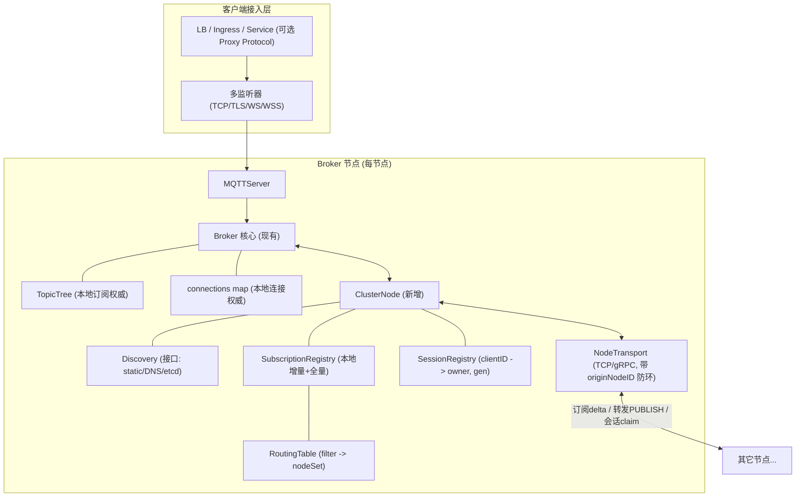
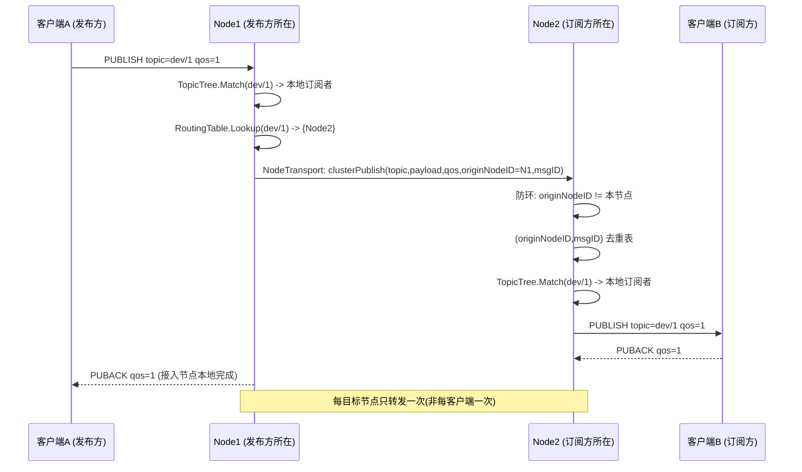
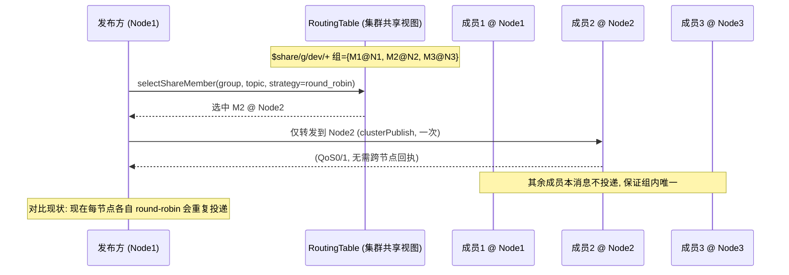

# Shark-MQTT 集群可行性架构评审（Cluster Feasibility Review）

- **文档类型**：架构评审（Architecture Review）
- **作者**：架构师 高见远（Gao）
- **日期**：2026-09-10
- **评审对象**：`github.com/X1aSheng/shark-mqtt`（本地 `G:\shark-mqtt`，Go 1.26.1，MIT）
- **上游输入**：产品经理 `docs/planning/SCALE-TARGETS.md`（L1–L4 分层与 EMQX 对标基线）
- **对应用户问题**：*"Shark-MQTT 能否集群部署，达到大规模目标？"*
- **评审方法**：源码逐文件/函数级静态阅读（非测试 Go 代码 27,265 行；`broker` 包 5,944 行）。**所有结论均给出 `文件:行` 或函数名证据；读不通处标注"待确认"，不臆测。**

---

## 1. 直接结论

### 1.1 三个问题，三个明确回答

| 问题 | 结论 | 一句话依据 |
|---|---|---|
| **现在能否集群部署？** | ❌ **不能。** | 集群相关代码 **0 文件**；连接状态、会话、订阅树、限流、遗嘱全部是**进程私有**的权威状态，节点间无任何通信通道。 |
| **能否达到大规模（L3/L4）？** | ❌ **现状不能；L3 需新建一整套分布式子系统才能触及，L4 不建议做。** | L2→L3 的结构性门槛是"跨节点路由 + 会话路由 + 故障转移"（SCALE-TARGETS §5.1 C1–C10），当前 **C1–C10 全部缺失**。 |
| **多副本能否变相扩容？** | ❌ **不能，且是生产陷阱。** | `deploy/k8s/app/deployment.yaml:10` `replicas: 2`、`values-prod.yaml:3` `replicaCount: 3` + `:20-21` HPA `3→20` + `:28` `redis` 后端，会产生 3–20 个**互不通信的独立 Broker**；MQTT 客户端经单一 Service 负载均衡后，订阅/会话会随机落到不同实例，导致**漏投、重复投、每次滚动重启触发遗嘱风暴、retained 分裂**。 |

> **注（单机容量口径）**：本文涉及的单机连接数上限，`max_connections` 是**可配置的准入闸门**（默认 10000、`0`=不限，`config/config.go:35,93`），**并非架构上限**；单机的真实资源上限见新增的 **§3 单机垂直扩容上限测算**。

### 1.2 证据链（可复核）

1. **集群相关代码为 0。** 全量关键词检索 `cluster / memberlist / gossip / raft / etcd / nats / serf / nodeid / instanceid` 于 `*.go` → **命中 0 个文件**（唯一两处命中是 `properties.go:131`、`broker.go:1180` 的注释里出现 "crafted"，属误匹配）。
2. **权威状态在进程内存中，且不可序列化。**
   - `broker/broker.go:25-47` `clientState` 持有真实 `net.Conn`——一个套接字**无法跨进程寻址或迁移**。
   - `broker/broker.go:66-67` `connections map[string]*clientState`（`mu sync.RWMutex` 保护）是"clientID → 连接"的**唯一权威表**，仅在本地读写（`HandleConnection` 写 `broker.go:517`；`connection()` 读 `broker.go:2025-2029`）。
   - `broker/session.go:129-134` `Manager.sessions map[string]*Session` 是**唯一权威会话表**；`Save()`/`Restore()`（`session.go:497-591`、`593-664`）只持久化 `SessionData` 的**子集**（`store/types.go:9-23`，**不含 topicAliases、流控计数、outboundQueue**），且只在断开时落盘（`broker.go:987-1008`），是**崩溃恢复快照**而非"共享的实时会话表"。
3. **订阅树是每节点全量本地副本。** `broker/broker.go:116` `topics: NewTopicTree()` 每实例一份；订阅只在本地 `SUBSCRIBE` 时写入（`broker.go:1570` `b.topics.Subscribe(...)`）；`Match()`（`topic_tree.go:122`）只读本地 trie。**节点 A 的发布无法发现节点 B 的订阅者。**
4. **共享订阅仅进程内 round-robin。** `routeSharedPublish`（`broker.go:2031-2040`）→ `MatchSharedOnline`（`topic_tree.go:313-415`）遍历本地 `sharedSubs` 与本地游标 `sharedLast`。跨节点时，两个节点各持同一 `$share` 组的部分成员，会**各自投递一份**（违反共享订阅"组内仅一份"语义）。
5. **配置模型不支持多监听器/集群参数。** `config/config.go:19-83` `Config` 是单 listener 结构（`ListenAddr string` + `WSListenAddr`/`WSSListenAddr`），**无 listener 数组，无 cluster/node/proxy_protocol 段**；配置仅在启动时读取一次（`cmd/main.go:52-59`），**无 SIGHUP/热重载**。
6. **无排空/移交语义。** `Broker.Stop()`（`broker.go:905-939`）在 `b.cancel()` 后**立即关闭所有客户端连接**（`:911-920`），随后最多等 5s 排空 inflight，**不做会话迁移、不做连接移交、不抑制遗嘱**。

### 1.3 一句话总结

> **Shark-MQTT 今天是一个协议内核完成度很高的 L1 单机 Broker。它距离"集群"不是"改个配置"的距离，而是缺一整个分布式子系统（成员管理、路由、会话归属、故障转移、分布式状态）。L3 可通过 3 个阶段新建该系统达成；L4（100+ 节点 / 多集群互联 / 99.99%）对"Go + 单二进制 + 零依赖"定位**不划算**，明确不建议做（见 §8）。**

> **补充澄清（针对"1 万连接"的常见误读）**：上文"不是改个配置"指的是**集群化**，与"单机连接数上限"是两回事。配置/文档中出现的 `max_connections = 10000` 只是**默认值**、**不是单机架构上限**（`config/config.go:35,93`；`broker/options.go:161-163`，`0`=不限）。单机的真实上限由资源（内存 / FD / CPU / 内核）决定，**10 万连接非天花板**；推导见 **§3 单机垂直扩容上限测算**。

---

## 2. 硬约束清单（阻碍集群化的具体设计）

> 每条给出：**问题 → 代码证据 → 对集群化的具体影响**。

### H1　连接状态是进程私有，且物理上不可迁移

- **问题**：`clientState` 内含 `net.Conn`，`Broker.connections` 是唯一权威连接表。
- **证据**：`broker/broker.go:25-47`（`conn net.Conn`）、`:66-67`（`connections map`）、`:509-517`（注册）、`:2024-2029`（`connection()` 只查本地）。
- **影响**：**跨节点寻址一个 clientID 在架构上不存在入口**。要在 Node2 上给"连在 Node1 的 clientID"发消息，必须新增"clientID → 所属节点"的全局映射 + 节点间传输层。这是 C2/C3 的根因。

### H2　会话归属节点无定义

- **问题**：会话只与"用户名"绑定（防跨用户劫持），从无"归属于哪个节点"的概念。
- **证据**：`broker/broker.go:298-329`（clientID↔username 校验）；`session.go:163-222`（`CreateSession` 只写本地 map）；全仓检索 `nodeid`/`owner` → 0。
- **影响**：C3（会话路由）无处挂载。粘性路由第一版必须先引入 **会话注册表（clientID → ownerNodeID + generation）**。

### H3　会话存储 ≠ 可共享的实时会话表

- **问题**：`SessionStore` 持久化的是快照子集，不是多节点可同时读写的实时状态。
- **证据**：`store/interfaces.go:9-21`（`SessionStore`：Save/Get/Delete/List/IsSessionExists/**RefreshSession**）；`store/types.go:9-23`（`SessionData` 无 topicAliases/流控/outboundQueue）；`session.go:497-591`（`Save` 含 inflight 与 inboundQoS2 深拷贝）。Redis 后端的 `ListSessions` 走 `SCAN`（`store/redis/session_store.go:98-107`），全表扫描风险（产品经理 S5）。
- **影响**：C6（分布式状态存储）不能靠"把 store 换成 Redis"直接解决——即使共享了 store，**实时连接/流控/别名状态仍在各节点内存里**；跨节点若都写同一 key，会话会互相覆盖（无 fencing）。

### H4　`TopicTree` 每节点全量副本，订阅无跨节点传播

- **问题**：订阅信息不做任何跨节点广播。
- **证据**：`broker/topic_tree.go:21-32`（内存 trie + `sharedSubs`）；`broker/broker.go:1570`（本地 Subscribe）；`topic_tree.go:122-142`（本地 Match）。
- **影响**：C2（跨节点路由）**根本不存在**。这是所有集群能力的**前置依赖**——没有"filter → node 集合"的路由表，发布无法定向到持有订阅的节点。

### H5　共享订阅调度范围 = 单进程

- **问题**：`$share` 组的成员集合与 round-robin 游标均为进程内。
- **证据**：`broker.go:2031-2040`；`topic_tree.go:306-415`（`sharedSubs`、`sharedLast`、`sort.Search` 选成员）；`broker.go:2018-2022`（`isClientOnline` 只查本地会话）。
- **影响**：C4（集群级共享订阅）缺失。当前多节点下 `$share` **只会重复投递**，不会真正分摊负载。改造点：组成员入全局注册表 + 发布时对"节点"而非"客户端"做一次选择。

### H6　消息 ID / 序列号：无节点维度

- **问题**：存储消息 ID 用"墙钟 + 进程内原子计数"，无节点前缀。
- **证据**：`broker/broker.go:79-82`（`msgSeq atomic.Uint64`）、`:1786-1788`（`fmt.Sprintf("%d-%d", time.Now().UnixNano(), msgSeq.Add(1))`）。
- **影响**：单机唯一，**跨节点不保证全局唯一**（依赖各节点时钟；NTP 漂移/回拨下理论可碰撞）。集群转发需 (originNodeID, msgID) 复合去重键 → ID 需加节点前缀。（会话内 packetID 是 per-session，`session.go:404-425`，跨节点不受影响。）

### H7　Retained 消息全局一致性不成立

- **问题**：retained 计数与过期时间为进程私有；`maxRetainedTopics` 为每节点限额。
- **证据**：`broker/broker.go:84-88`（`retainedCount`/`retainedExpirations`）、`:1442-1499`（`handleRetainedMessage` 持 `retainedMu`）、`:1464-1470`（每节点限额）。
- **影响**：*投递路径* 走 `retainedStore`（`broker.go:2042-2082`），因此**若集群统一使用共享 RetainedStore（如 Redis），retained 的读写可以全局可见**——这是本仓最接近"可分布式"的一处。但**计数、TTL、限额仍是每节点**：`$SYS/broker/retained` 各节点不同，TTL 清理各节点独立执行（可能重复删除，幂等可接受）。集群模式需规定"retained 必须用共享后端"或接受 per-node 语义。

### H8　$SYS 指标是单节点值，无聚合

- **问题**：状态主题直接发布本地计数。
- **证据**：`broker/broker.go:876-886`（`len(b.connections)`、`retainedCount`、`topics.SubscriberCount()`）、`:896-898`（只投递给本地订阅者）。
- **影响**：C7（集群级监控）缺失。`$SYS/broker/connections` 在多节点下是"本节点连接数"，监控会误读。需引入节点前缀命名空间（`$SYS/cluster/{nodeID}/...`）或聚合器。

### H9　配置模型阻碍多监听器与集群参数

- **问题**：单 listener 结构 + 仅启动时读取。
- **证据**：`config/config.go:21-23`、`:86-107`、`:110-169`；`config/loader.go:27-74`；`cmd/main.go:52-59`（启动加载一次，无 SIGHUP）。
- **影响**：C9（多监听器/Proxy Protocol）与 S2（热重载）、S3（listener 数组）在配置层被阻塞。集群参数（nodeID、seeds、discovery、cluster port）也无处声明。

### H10　关闭无排空/移交，且会误触发遗嘱

- **问题**：`Stop()` 直接关连接、无迁移、无遗嘱抑制。
- **证据**：`broker.go:905-939`；关连接后 `readLoop` 的 `Decode` 报错会走 `abnormalDisconnect`（`broker.go:1092`）→ `will.TriggerWill`（`broker.go:2460-2468`），而 `Stop()` 未调用 `will.RemoveWill`。
- **影响**：**滚动升级/节点重启会引发遗嘱风暴**（所有被关闭连接的遗嘱被当作"异常掉线"发布），对下游是"设备大面积离线"误报。集群化必须补：优雅 drain（先停止接新连接 → 通知客户端/迁移 → 抑制或延迟遗嘱 → 排空）。

### H11　限流/配额是进程私有

- **问题**：连接限流与发布限流均为内存滑动窗口。
- **证据**：`broker/rate_limit.go:10-55`（`connRateLimiter`）、`:64-107`（`publishRateTracker`）；`broker.go:90-91,179-191`（连接级）；`session.go:47`（会话级）。
- **影响**：C8（分布式限流）缺失。多节点下"每客户端 N msg/s"实际是"每节点 N msg/s"；集群总配额无法表达。

### H12　遗嘱处理是进程私有，且与套接字绑定

- **问题**：遗嘱表在内存，`WillMessage.Conn` 绑定套接字。
- **证据**：`broker/will_handler.go:11-36`、`:66-87`（注册）、`:93-132`（触发，含 `will.Conn != conn` 归属校验）。
- **影响**：**持有遗嘱的节点崩溃时，没有其它节点知道该遗嘱存在，遗嘱永不发布**——恰在"最需要离线检测"时丢失。集群遗嘱需状态复制（R=2 副本）或引入网关级遗嘱。

### H13　认证/授权/插件均为进程私有

- **问题**：`authenticator`/`authorizer`/`pluginMgr` 由宿主注入单进程。
- **证据**：`broker/options.go:15-25`；`plugin/manager.go:42-50`。
- **影响**：集群下 ACL/认证变更需分发或改为集中认证（可通过可选外部后端解决，非阻塞，但需设计）（优先级低于 H1–H12）。

---

## 3. 单机垂直扩容上限测算

> **触发**：用户指出 `max_connections` 是**可修改的配置**（非架构硬上限）。既然连接数不受配置限制，就必须回答下一个问题：**单机的真实上限在哪里？** 本节从**配置层 / 资源层 / 内核层**给出推导，并诚实标注验证边界。
> **数据口径**：每连接资源成本取自本仓唯一实测报告 `docs/reports/RESOURCE-ANALYSIS-260829.md`（**1,000 连接**口径；Windows 11 / Ryzen 7 8845HS / Go 1.26.1）；配置与代码行为给出 `文件:行` 证据。

**结论先行**：`max_connections` 改成 200000 不会被架构拒绝；单机连接数的**真实上限由内存决定**（最紧约束）——1 万只是默认值，10 万在 32 GB 档仅用其约 1/4 内存即可承载，**10 万不是天花板**。但**目前只有 1,000 连接的实测数据**，1 万以上一切均为**外推估算**（详见 §3.4）。

### 3.1 配置层面的上限：上限是"配置的"，不是"架构的"

| 入口 / 环节 | 位置 | 语义 |
|---|---|---|
| 配置文件 / 环境变量 | `config/config.go:35` | `yaml: max_connections`、`env: MQTT_MAX_CONNECTIONS`；`Validate()` 仅校验 `>= 0`（`config.go:117-119`），**无上界** |
| 编程式 Option | `broker/options.go:163` | `WithMaxConnections(n)`；**`0` = 不限**（`options.go:161-162`） |
| 默认值 | `config/config.go:93`、`broker/options.go:65` | 均为 `10000`——**仅默认值** |
| API 回落 | `api/api.go:114`（`0`=不限、`-1`=回落 config）、`api/api.go:214-215` | API 未显式设置时用 config 值；显式 `0` 透传到 broker，不回落默认 |
| 生效条件 | `broker/server.go:242`、`broker/broker.go:168-175` | **仅当 `> 0`** 才做上限判断与拒绝；`0` 时完全不拦截 |

**结论**：`max_connections` 是一道**准入闸门数值**，不是架构边界。把它从 10000 改成 200000 不会报错、不会被任何架构层拒绝——真正的上限由 §3.2 的资源决定。

### 3.2 资源层面的真实上限

#### 3.2.1 内存（核心约束）

**计算依据**：`所需内存 ≈ 连接数 × 每连接增量`。每连接增量取自 RESOURCE-ANALYSIS §1.1（1,000 连接实测：WorkingSet **+29.7 KB/连接**、私有内存 **+31.5 KB/连接**）与 §1.3 结论「**稳态 ~30 KB/连接、峰值 ~55 KB/连接**（发布在途缓冲）」。

| 目标连接数 | 稳态口径（30 KB/连接） | 峰值口径（55 KB/连接） |
|---|---|---|
| 1 万 | ≈ 0.3 GB | ≈ 0.55 GB |
| **10 万** | ≈ 3.0 GB | **≈ 5.5 GB** |
| 50 万 | ≈ 15 GB | ≈ 27.5 GB |
| 100 万 | ≈ 30 GB | ≈ 55 GB |

> 进程基线（0 连接）约 10.7 MB WorkingSet / 47.5 MB 私有（RESOURCE-ANALYSIS §1.1），相对可忽略，未计入上表。

**容量规划公式（保守）**：

```
所需内存 ≈ 峰值口径 × 连接数 × 1.5（GOGC / 堆碎片余量） + 进程基线 + 内核 socket 缓冲
```

- **必须按峰值口径规划**：Go GC **不归还 OS 内存**（RESOURCE-ANALYSIS §1.3）——发布高峰涨上去的堆不会自动还给操作系统。若按稳态 30 KB 规划，遇到发布洪峰即 OOM。
- **内核 socket 缓冲另计**（**不在**进程 RSS 内）：每个空闲 socket 在内核约占 4–8 KB（`tcp_rmem/wmem` 下限），并随流量自动增长。10 万连接 ≈ 0.4–0.8 GB；100 万连接 ≈ 4–8 GB（**估算 / 待验证**）。

#### 3.2.2 文件描述符

**计算依据**：RESOURCE-ANALYSIS §1.1 句柄增量 **~1.1/连接**（≈1 socket/连接）。另需：监听器（TCP/TLS/WS/WSS ≤ 8）+ metrics/HTTP 监听（1–2）+ Go runtime 内部 FD（epoll/eventfd/pipe，典型 10–40）。

| 目标连接数 | 需要句柄 | 建议 `ulimit -n`（进程，≈2× 余量） | 建议 `fs.file-max`（系统） |
|---|---|---|---|
| 1 万 | ≈ 11,000 | 65,536 | 1,048,576 |
| 10 万 | ≈ 110,000 | 262,144 | 1,048,576 |
| 50 万 | ≈ 550,000 | 1,048,576 | 2,097,152 |
| 100 万 | ≈ 1,100,000 | 2,097,152 | 4,194,304 |

> 余量用于重连抖动、TIME_WAIT 残留、以及优雅 drain 期间新旧连接并存。**FD 是最好扩的一维**（`limits.conf` / systemd `LimitNOFILE` / K8s `securityContext`），通常不是最终瓶颈。

#### 3.2.3 CPU / 调度 / GC

- **goroutine 模型 = 2 个/连接**：①`HandleConnection`→`readLoop`（`broker/server.go:258` 每连接起 1 个 goroutine；`broker/broker.go:561,1079` 内联执行读循环）；②`writeLoop`（`broker/broker.go:520` `go cs.writeLoop()`）。
- **keep-alive 无额外 goroutine**：靠**读超时**实现（`broker/broker.go:1101` `setKeepAliveDeadline`；超时在 `:1083-1093` 被当作僵尸连接回收），**没有每连接 ticker / 定时器 goroutine**——这是一项重要的成本优势。
- **10 万连接 ⇒ ~20 万 goroutine**。实测 1,000 连接对应 **2,000+ goroutine / 12 个 OS 线程**（RESOURCE-ANALYSIS §1.1），即 Go 调度器把 ~167 个 goroutine 多路复用到 1 个线程。空闲连接阻塞在 epoll 上，**CPU 近零**（30 s 稳态 CPU 仅 0.42 s，RESOURCE-ANALYSIS §1.2）。
- **CPU 热路径在消息处理，不在空闲连接**：实测 60K 条发布（10% QoS1）耗时 3.34 s、约 5 核并行（RESOURCE-ANALYSIS §1.2）⇒ **≈ 1.8 万 msg/s 入站**。该数值与 §7 阶段 0「50 万 msg/s 量级」的目标差距很大，**msg/s 维度完全无达标证据，须由 T06 产出**。
- **goroutine 栈**：初始 8 KB（Go 1.19+），阻塞于 read 的连接栈保持很小；已含在每连接实测内。
- **GC**：活跃对象（连接 / 订阅 / 在途消息）随规模线性增长，标记阶段变长；建议用 `GOMEMLIMIT` + `GOGC` 约束堆上限，与 §3.2.1 的峰值口径配合。

#### 3.2.4 每连接固定开销（写队列）

- `WriteQueueSize` 默认 **256**（`config/config.go:94`、`broker/options.go:75`），每连接创建 `out chan protocol.Packet`（`broker/broker.go:39,505-513`），容量 256。
- `protocol.Packet` 是**接口类型**（16 B/元素）⇒ channel 环形缓冲 = `256 × 16 B = 4 KB/连接`；再加 `hchan` 头 ~96 B 与 `stopWrites` channel ~96 B ⇒ **≈ 4.2 KB/连接**，是**与流量无关的固定占用**。
- 规模换算：10 万连接 ≈ **0.4 GB**；100 万连接 ≈ **4 GB**（**仅写队列本身**）。
- **权衡**：调小 `WriteQueueSize`（如 64 ⇒ ~1 KB/连接）可显著省内存，但削弱慢消费者吸抖能力；调大则增加抗背压上限与内存。**容量规划须把这 ≈4 KB 计入每连接成本**（它已含在 30 KB 实测口径内）。

#### 3.2.5 内核网络

单个连接在内核侧还消耗 socket 结构 + 收发缓冲 +（NAT/LB 下）conntrack 条目。要点：

- **conntrack 是 K8s / NAT 场景的头号隐形瓶颈**：每连接占 **1 条** conntrack，表满会**静默丢包**（表现为"能连上、随后卡死"）。10 万连接档须把 `nf_conntrack_max` 提到 ≥ 26 万。
- **accept 队列**：`somaxconn` / `tcp_max_syn_backlog` 过小，会在连接风暴（如大规模重连）时丢 SYN，表现为随机连接超时。
- **socket 内存**：见 §3.2.1 中"内核 socket 缓冲另计"。

参数建议值见 §3.3。

#### 3.2.6 三档硬件对照表（理论上限 × 验证状态）

> 假设：**≤ 70% 物理内存**可用于连接数据（余 30% 给 OS、Go 进程基线、GC 余量与内核 socket 缓冲）。"内存允许连接"为**线性外推（估算）**。

| 档位 | vCPU / 内存 | 可用内存 | 内存允许连接（稳态 30 KB） | 内存允许连接（峰值 55 KB） | 推荐运行点（≈50% 峰值上限） | 验证状态 |
|---|---|---|---|---|---|---|
| **小型** | 2–4 vCPU / 8 GB | ≈ 5.6 GB | ≈ 18 万 | ≈ 10 万 | **5 万** | ⚠️ 仅 1,000 级实测 |
| **中型** | 8–16 vCPU / 32 GB | ≈ 22.4 GB | ≈ 73 万 | ≈ 40 万 | **20 万** | ⚠️ 仅 1,000 级实测 |
| **大型** | 32 vCPU / 128 GB | ≈ 89.6 GB | ≈ 290 万 | ≈ 160 万 | **80 万** | ⚠️ 仅 1,000 级实测 |

**读法**：
- **连接数上限主要由内存决定**（最紧约束），FD 与 CPU 一般更宽松；但**高吞吐（msg/s）时 CPU 会变成更紧的约束**，且该维度当前无实测。
- **10 万连接不是天花板**：中型档（32 GB）按其**可用内存**（≈22.4 GB）的 **~25%** 即可承载（10 万 × 55 KB ≈ 5.5 GB）。§7 阶段 0 的"10 万连接"是**保守可达目标**，而非架构上限。
- 上表**全部为外推估算**：唯一实测点是 **1,000 连接**（RESOURCE-ANALYSIS §1）；**1 万以上无任何数据**。

### 3.3 内核与系统调优清单

| 类别 | 参数 | 建议值（10 万连接档） | 说明 |
|---|---|---|---|
| 文件句柄 | `fs.file-max` | ≥ 2,000,000 | 系统级最大句柄数（见 §3.2.2） |
| | `ulimit -n` / `LimitNOFILE` | 262,144（10 万）/ 1,048,576（50 万） | 进程级；容器需在 `securityContext` 放开 |
| 连接队列 | `net.core.somaxconn` | 65535 | accept 队列长度 |
| | `net.ipv4.tcp_max_syn_backlog` | 65535 | SYN 半连接队列 |
| | `net.core.netdev_max_backlog` | 65535 | 网卡→协议栈队列（高 PPS） |
| 收发缓冲 | `net.core.rmem_max` / `net.core.wmem_max` | 16,777,216 | 单 socket 缓冲上限 |
| | `net.ipv4.tcp_rmem` | `4096 87380 6291456` | 接收缓冲自动调优区间 |
| | `net.ipv4.tcp_wmem` | `4096 65536 6291456` | 发送缓冲自动调优区间 |
| NAT / conntrack | `net.netfilter.nf_conntrack_max` | ≥ 2 × 连接数（10 万 → 524288） | 每连接 1 条；**K8s / LB 场景必调** |
| | `net.netfilter.nf_conntrack_buckets` | `nf_conntrack_max / 4` | 哈希桶，防查找退化 |
| TCP 生命周期 | `net.ipv4.tcp_fin_timeout` | 15–30 | TIME_WAIT 回收 |
| | `net.ipv4.tcp_tw_reuse` | 1 | 复用 TIME_WAIT（出向，节点间 / Bridge） |
| | `net.ipv4.ip_local_port_range` | `10240 65535` | 出向临时端口范围 |
| 探活 | `net.ipv4.tcp_keepalive_time/intvl/probes` | 与 `tcp_keepalive_period` 一致（`config/config.go:41`） | OS 级僵尸连接回收（MQTT KeepAlive=0 时的兜底） |

> **应用侧对应项**：`TCPKeepAlivePeriod`（`config/config.go:41`）已由 `configureTCPKeepAlive`（`broker/server.go:298-321`）落到每个 accepted 连接（含 TLS/WSS）。

### 3.4 诚实的边界说明（重要）

**三个"上限"必须区分清楚**：

| 层级 | 含义 | 本项目现状 |
|---|---|---|
| **【理论可配置上限】** | `max_connections=0` 时无代码上限，仅受 OS 资源约束 | §3.2 的线性测算（**外推估算，未经实测**） |
| **【实验室已验证上限】** | 有实测数据支撑的规模 | **1,000 连接**（RESOURCE-ANALYSIS §1；仅资源占用，**非**长跑、**非**负载 P99） |
| **【生产已验证上限】** | 真实生产长期运行验证 | **无（0 数据）** |

- **1 万以上没有任何实测**：既无**长跑稳定性数据**（数小时 / 数天的内存漂移、FD 泄漏、GC 表现），也无**负载下 P99 数据**。
- 因此 **§7 阶段 0 的 T06（P99 负载延迟实测）与"10 万连接稳定性长跑"是准入 L2 的必经验证项，不是可选项**——它们是把本节的外推估算变成工程事实的唯一途径。
- 本节所有"允许连接数"均为**按 30 / 55 KB 的线性外推**。大数下 GC 停顿、调度延迟、内核 socket 内存、conntrack 行为都可能**非线性**，实测前应视为**上界估计**。
- **标注约定**：**估算** = 线性外推、无实测；**待验证** = 有依据但未跑过；文中已逐处标注。

---

## 4. 目标集群架构设计

### 4.0 设计前提（对产品经理 Open Questions 的显式假设）

> 以下两条作为**基线假设**并论证；其余问题标注为"需用户拍板"（§9）。

**假设 A（对应 Q3）：集群第一版只做"粘性路由（sticky）"，不实现会话迁移。**
- **理由**：会话迁移要求①序列化"活"会话（但 `clientState` 含 `net.Conn`，物理不可搬，H1）；②迁移 inflight/流控/别名等内存态（H3）；③切换期间双写幂等与 fencing 防双主；④切换期间的 socket 缓冲与半包处理。这是一个**高复杂度、高风险**的独立子系统，且收益仅在"节点故障时保留在线会话"（而 MQTT 客户端本就具备重连能力）。
- **代价（诚实说明）**：粘性下，节点故障时其上的**在线持久会话**只能等客户端重连后在新节点**重建**（订阅从 SessionStore/集群订阅表恢复，离线队列从 MessageStore 恢复），迁移期间的 QoS1/2 在途消息靠重投保证不丢；**在线瞬间的 P99 会受重连风暴影响**。以复杂度换这是**正确的第一版取舍**。

**假设 B（对应 Q7）：集群方案不强制引入外部中间件；保持零依赖/可嵌入/MIT 定位。**
- **理由**：零依赖/单二进制/可嵌入/MIT 是 Shark-MQTT 相对 EMQX（Erlang 运行时 + 集群中间件 + BSL）的**核心差异化**（`docs/reports/EMQX-GAP-ANALYSIS-260910.md` §二、§六）。若集群必须依赖 etcd/Redis，则"边缘/嵌入式"场景（SCALE-TARGETS L1 主战场）直接被排除，且引入 SPOF 与运维成本。
- **落地方式**：成员管理用 **纯 Go、MIT 的 `hashicorp/memberlist`（SWIM）**；discovery 抽象为接口，**默认 static/DNS**，**etcd 作为可选插件**（K8s 用户可选，非必需）；不强制共享存储——共享 `RetainedStore`/`MessageStore`（Redis）为**可选增强**，用于跨节点持久离线队列，非同构前提。

### 4.1 三条技术路线对比

| 维度 | **路线 A：自研 gossip + 广播式路由表**（推荐） | **路线 B：外部协调层（etcd/Redis）** | **路线 C：复用 NATS / JetStream 做节点间总线** |
|---|---|---|---|
| 成员管理 | `hashicorp/memberlist`（SWIM，纯 Go，MIT） | etcd lease+watch（Raft）或 Redis | NATS cluster routes（可嵌入 `nats-server`） |
| 消息/路由 | 节点间自建传输（TCP/gRPC）+ 订阅 delta 广播 + 周期 anti-entropy | 路由表存 etcd/Redis，watch 感知 | 借 NATS subject 做节点间 pub/sub |
| 复杂度 | **中**（需自研路由表 + 传输，但零外部依赖） | 低-中（复用成熟一致性组件） | 中-高（学一套新语义，且需再设计 MQTT 路由） |
| 一致性模型 | 最终一致（订阅表）；成员视图经 SWIM 弱一致 | etcd 强一致 / Redis 最终一致 | 依赖 NATS，最终一致 |
| 最大节点数 | 全互联网表在 ~7–15 节点良好；更大需分层 | ≤100 良好（etcd 扛得住） | 高（NATS 可大规模） |
| 外部依赖 | **0（可选 etcd）** | **强制 etcd/Redis**（破坏定位） | **0（NATS 可嵌入）** 但引入大依赖 |
| 运维成本 | 低（自包含） | 高（多一个必须高可用的集群组件） | 中 |
| 与现有 `store` 接口契合度 | 高（store 保持可选，正交） | 中（易诱导强依赖） | 中 |
| 对定位的影响 | ✅ 保持零依赖/可嵌入/MIT | ❌ 破坏"边缘可嵌入" | 🟡 保单二进制，但引入可观依赖与学习成本 |

**推荐：路线 A 为基线，吸收 B 的"可选 etcd discovery"，将 C 列为传输层技术预研（spike）而非基线。**

**推荐理由**：
1. **唯一同时满足"假设 B（零依赖）"与"中等复杂度"**的方案。memberlist 与用户自建传输均为纯 Go，可 `go build` 进单二进制。
2. **与现有 `store` 接口正交**：路由与会话归属不需触碰 `store` 三接口，改动面可控。
3. **路线 B 的 etcd 一旦进入关键路径，"单二进制/边缘/嵌入"卖点即失效**——这是定位级风险，不可接受为默认。
4. **路线 C 的 NATS 虽可嵌入**，但它解决的是"传输"，MQTT 感知的路由/会话/共享订阅语义仍需自研；即"多背一套总线语义，却省不掉核心工作"，投入产出比不佳。

### 4.2 推荐架构（组件与数据流）



**核心新增组件（职责）**
- **`Discovery`**：成员发现与视图。v1 static/DNS；可选 etcd。接口化，不破坏零依赖。
- **`ClusterNode`**：集群门面，编排 discovery / registry / transport。
- **`SubscriptionRegistry`**：把本地订阅变化（SUBSCRIBE/UNSUBSCRIBE/DISCONNECT）编码为 delta 广播；周期性全量对账（anti-entropy，版本向量）。
- **`RoutingTable`**：`filter → set(nodeID)`，**反向索引**加速 `Match`；本地发布时用"本地树匹配 + 路由表匹配"求并集目标节点。
- **`SessionRegistry`**：`clientID → {ownerNodeID, generation}`。generation 为 fencing token，防双主。
- **`NodeTransport`**：节点间投递与控制通道，消息带 `originNodeID`+`msgID` 防环与去重。

**投递语义（关键设计）**
- 非共享订阅：发布节点对每个**目标节点**转发**一次**（不是每客户端一次），接收节点本地扇出。
- QoS：跨节点按**至少一次**，接收端按 `(originNodeID, msgID)` 去重；QoS2 的握手在"接入节点↔客户端"之间完成，跨节点只做一次性转发，避免分布式 QoS2 四段握手（明确简化，写入文档）。
- 共享订阅：`RoutingTable` 额外维护 `shareGroup → members(nodeID)`；发布时对**节点集合**做 round-robin（谓词可选 sticky/hash），只转发到被选中的节点。

---

## 5. 关键流程时序图

### 5.1 跨节点发布订阅投递路径



### 5.2 共享订阅跨节点选择



### 5.3 节点加入/离开与路由表收敛

```mermaid
sequenceDiagram
    participant N1 as Node1 (已在集群)
    participant N2 as Node2 (新加入)
    participant N3 as Node3 (已在集群)
    N2->>N1: join(seeds) via memberlist (SWIM gossip)
    N1->>N2: 集群视图确认 (含 Node3)
    N2->>N1: SyncRequest (携带本地订阅表 version)
    N1-->>N2: 全量订阅快照 (filter -> N1订阅; version)
    N2->>N3: SyncRequest
    N3-->>N2: 全量订阅快照 (filter -> N3订阅; version)
    Note over N1,N3: 稳态: 订阅/退订事件以 delta 增量广播
    Note over N1,N3: 周期 anti-entropy: 版本向量对账, 修复丢失的 delta
    N3->>N1: 心跳 (SWIM ping/ack)
    Note over N1,N3: 心跳超时 -> suspect -> dead -> 触发 §5.4 接管流程
```

### 5.4 节点故障时会话与订阅接管（含 will 与 retained 语义）

```mermaid
sequenceDiagram
    participant N1 as Node1 (存活)
    participant N2 as Node2 (故障)
    participant REG as SessionRegistry / 成员视图
    participant N3 as Node3 (接管)
    participant C as 客户端 (原连 Node2)
    REG-->>N1: Node2 心跳超时 -> suspect -> dead
    N1->>REG: 回收 Node2 拥有的全部会话 (clientID -> owner=N2)
    REG->>REG: 失效 N2 的会话租约 (generation++)
    REG->>REG: 发布 N2 名下的 will (尽力而为; v1 若未复制则会丢失)
    N1->>N1: RoutingTable 移除 N2 的订阅条目
    C->>N3: 重连 (CleanSession=false) — 客户端自带重连
    N3->>REG: Claim(clientID, generation=新值)  fencing
    REG-->>N3: 授权 (旧 owner N2 已失效, 拒绝迟到写)
    N3->>N3: SessionStore.Restore(clientID) 恢复订阅/离线队列
    N3->>N3: 重建本地 TopicTree + 广播订阅 delta
    N3-->>C: CONNACK SessionPresent=1
    Note over N1,N3: retained: 由共享 RetainedStore 提供全局一致(若启用); 否则 per-node 语义(文档声明)
```

---

## 6. 集群化改造任务分解（有序、带依赖）

> 量级：**S** ≤ ~300 行 / **M** ~300–1000 行 / **L** > 1000 行 或跨包结构改动。风险：低/中/高。**所有任务相对路径基于仓库根。**
> **前提**：§7 阶段 0（单机平台化）为集群的前置，下表中 P0-S 系列即阶段 0 项。

### 6.1 阶段 0：单机平台化（集群前置）

| # | 任务 | 涉及文件（相对路径） | 量级 | 风险 | 依赖 | 验收方式 |
|---|---|---|---|---|---|---|
| T01 | 多监听器配置模型（`Listeners []Listener`，含 TCP/TLS/WS/WSS、`ProxyProtocol` 开关） | `config/config.go`, `config/loader.go`, `broker/server.go`, `api/api.go`, `cmd/main.go` | M | 中 | — | 单进程同时起 3 个监听器；旧单字段配置向后兼容；单测覆盖解析 |
| T02 | HTTP 管理 API 最小集（`GET /clients`、`DELETE /clients/{id}`、`GET /subscriptions`、`GET /retained`、`POST /publish`） | `api/api.go`(新 `api/admin.go`), `broker/broker.go`(暴露只读快照/踢下线), `broker/session.go` | M | 中 | T01 | 集成测试：列出/踢下线/发布可用；鉴权 fail-closed |
| T03 | 配置热重载（SIGHUP + `POST /reload`），可热更子集（限流/日志/ACL），不可热更项显式报错 | `config/loader.go`, `broker/broker.go`, `api/api.go`, `cmd/main.go` | M | 中 | T01,T02 | 改限流阈值后无需重启生效；非法变更被拒绝且不破坏运行 |
| T04 | 存储后端批量/原子操作（消除 `SCAN` 全表与逐条） | `store/interfaces.go`, `store/redis/*.go`, `store/badger/*.go`, `store/memory/*.go` | M | 中 | — | 会话量 10 万级时 `ListSessions`/离线队列延迟有界；基准对比 |
| T05 | 优雅 drain 与遗嘱抑制（Stop 分阶段：拒新→通知→排空→抑制遗嘱） | `broker/broker.go`(`Stop`/`will_handler.go`), `broker/server.go` | M | **高** | — | 滚动重启集成测试：无遗嘱风暴、无丢消息 |
| T06 | P99 负载延迟实测与 SLO 基线（负载下端到端 P99） | `tests/bench/*`, `docs/guides/PERFORMANCE.md` | S | 低 | T05 | 输出 P99 报告，作为 L2 准入证据 |

### 6.2 阶段 1：最小可用集群

| # | 任务 | 涉及文件（相对路径） | 量级 | 风险 | 依赖 | 验收方式 |
|---|---|---|---|---|---|---|
| T07 | 集群配置模型 + 节点身份（`nodeID`、seeds、cluster 端口、`discovery`） | `config/config.go`, `config/loader.go`, `broker/broker.go` | S | 低 | T01 | 配置校验；nodeID 稳定可复现 |
| T08 | `Discovery` 接口 + static/DNS 实现 + memberlist 成员管理 | `cluster/discovery.go`, `cluster/memberlist.go`, `go.mod`(新增 memberlist) | M | 中 | T07 | 3 节点互相发现；节点上下线事件可观测 |
| T09 | `SessionRegistry`（clientID → owner + generation，fencing） | `cluster/session_registry.go`, `broker/broker.go`(接入 CONNECT/disconnect) | M | **高** | T08 | 同 clientID 跨节点接管被正确拒绝/授权；无双主 |
| T10 | `SubscriptionRegistry` + `RoutingTable`（本地订阅 delta 广播 + 全量对账） | `cluster/subscription_registry.go`, `cluster/routing_table.go`, `broker/topic_tree.go`(导出快照), `broker/broker.go` | L | **高** | T08 | 2 节点：A 订阅 `dev/+`，B 发布，A 收到；退订后不再收 |
| T11 | `NodeTransport` + 跨节点投递 + 防环/去重（含消息 ID 加节点前缀） | `cluster/transport.go`, `cluster/publish.go`, `broker/broker.go`(`handlePublish` 接入) | L | **高** | T09,T10 | 跨节点 QoS0/1 投递正确；环路注入测试不无限循环 |
| T12 | 集群级共享订阅（组成员注册 + 对"节点"调度，round-robin/hash） | `cluster/share.go`, `broker/topic_tree.go`(`MatchShared*` 改造), `broker/broker.go`(`routeSharedPublish`) | M | **高** | T10,T11 | 3 节点同 `$share`：每条消息**仅一个**成员收到 |
| T13 | 集群监控与 `$SYS` 命名空间（`$SYS/cluster/{nodeID}/...`，集群概览 API） | `broker/broker.go`(`publishSystemStatus`), `api/api.go`, `pkg/metrics/*` | S | 低 | T02,T08 | 各节点指标可区分；集群概览汇总连接/订阅数 |

### 6.3 阶段 2：生产级集群（L3 达标）

| # | 任务 | 涉及文件（相对路径） | 量级 | 风险 | 依赖 | 验收方式 |
|---|---|---|---|---|---|---|
| T14 | 故障检测与接管编排（成员 dead → 回收会话/订阅 → 客户端重连重建） | `cluster/failover.go`, `cluster/session_registry.go`, `broker/broker.go` | L | **高** | T09,T10,T11 | 杀节点：重连后会话/订阅恢复，无脑裂 |
| T15 | 遗嘱复制（R=2 副本）或网关级遗嘱 | `cluster/will_replication.go`, `broker/will_handler.go` | M | **高** | T14 | 单节点崩溃后遗嘱仍被发布；回归测试 |
| T16 | 分布式限流/配额（全局或按节点聚合语义） | `broker/rate_limit.go`, `cluster/quota.go`, `config/config.go` | M | 中 | T08 | 集群总配额可配置且行为符合定义 |
| T17 | 集群运维：滚动升级编排、集群级配置热重载、LB/Proxy Protocol 真实 IP | `cluster/ops.go`, `broker/server.go`, `config/config.go`, `deploy/k8s/*` | M | 中 | T05,T03,T01 | 滚动升级零遗嘱风暴、真实 IP 正确解析 |
| T18 | 集群验证套件（多节点 chaos/一致性/性能基准） | `tests/cluster/*`, `docs/architecture/CLUSTER-OPS.md` | M | 中 | T14,T15,T16,T17 | 3/5 节点常态+故障基准达 L3 门槛 |

**关键路径**：T01→T07→T08→T09/T10→T11→T12→T14→T15→T18。**T09/T10/T11/T12/T14/T15 为高风险项**，建议每项先出"设计评审 + 原型 spike"再实现。

---

## 7. 分阶段演进路线

| 阶段 | 目标 | 可达规模层级 | 验证方式 | **明确不做（控范围）** |
|---|---|---|---|---|
| **阶段 0：单机平台化** | 让单机 Broker 可运维、可调优，压到单节点极限 | **L1 → L2 上限**（单高配节点：10 万连接 / 50 万 msg/s 量级，**P99 待实测**；**10 万连接系保守可达目标而非天花板**，资源推导见 §3） | S1–S6 项验收 + P99 负载报告 + 10 万连接稳定性长跑 | ❌ 不引入集群；❌ 不做规则引擎/桥接；❌ 不做 Dashboard |
| **阶段 1：最小可用集群** | 建"发现 + 路由 + 粘性会话 + 跨节点共享订阅 + 集群监控" | **L3 下沿**（3–10 节点，10 万–100 万连接可达；**P99 ≤10ms 与 99.95% SLA 尚未达标**） | 3/5 节点跨节点投递正确性 + 共享订阅唯一性 + 节点上下线收敛 | ❌ 不做会话迁移；❌ 不做遗嘱复制；❌ 不做分布式配额；❌ 不做多集群/区域互联 |
| **阶段 2：生产级集群** | 补故障转移、遗嘱复制、分布式配额、集群运维 | **L3 主体达标**（3–10 节点，SLA 99.95% 可达，P99 需压测佐证） | T14–T18 验收；chaos（杀节点/网络分区）+ 性能基准 | ❌ 不做 100+ 节点 core/replicant；❌ 不做一致性哈希全量路由；❌ 不做 Erlang 式热加载；❌ 不做 L4 多集群互联 |

**L4（>100 万连接 / >500 万 msg/s / 10–100+ 节点 / 99.99%）**：**不在推荐路线内**，理由见 §8。

---

## 8. 明确的「不建议做 / 代价过高」清单

| # | 不建议项 | 为什么对"Go + 单二进制 + 零依赖"定位不划算 |
|---|---|---|
| N1 | **全量 100 节点 core/replicant 读写分离架构**（EMQX 式） | 需要独立的 core（管理路由/会话）+ replicant（承接连接）角色、专用路由层与再平衡器。运维复杂度、脑裂处理、调试难度剧增；而 Shark-MQTT 目标客户（边缘/中型 IoT）**不需要 100 节点**。建议封顶 ~7–15 节点全互联，更大规模走 Bridge/多区域（另立项目）。 |
| N2 | **Erlang 式运行时热加载（无停机换代码）** | Go 无 OTP 的代码热交换能力。伪造"热加载"会引入未定义行为。**正解**：配置热重载（T03）+ 滚动重启（T17），把"变更"限制在配置层。 |
| N3 | **强一致（线性一致）会话表** | 需 Raft/Paxos 或 etcd，直接破坏零依赖定位（H3、假设 B），且对 MQTT（可重连、最终一致足够）收益极低。**正解**：粘性 + 最终一致 + fencing。 |
| N4 | **自研一致性哈希/DHT 全量路由** | 实现与调试成本极高，且一致性哈希的再平衡（节点增删）会引发路由抖动。**正解**：订阅 delta 广播 + 周期 anti-entropy（T10）。 |
| N5 | **第一版做会话迁移** | 见假设 A：`net.Conn` 不可搬（H1），内存态不可序列化（H3），需 fencing 防双主，收益仅在"故障保留在线会话"——性价比最低。推迟到明确有付费/关键场景需求时再做。 |
| N6 | **强制依赖 etcd/Redis 才能起集群** | 破坏"边缘可嵌入"卖点（假设 B）。**正解**：etcd 仅作**可选** discovery；共享存储仅作**可选**增强。 |
| N7 | **内置 Dashboard / 可视化编排** | 与"单二进制轻量"定位冲突，收益低。**正解**：HTTP API（T02/T13）+ Grafana 模板。 |
| N8 | **集群版同时塞入规则引擎/Kafka 桥接/多协议网关** | 分散火力。集群与数据集成是**两条独立价值线**，应串行推进，避免同时铺开导致两条线都不达生产级。 |
| N9 | **QoS2 跨节点四段分布式握手** | 分布式事务式握手会显著抬高延迟与复杂度。**正解**：跨节点只做一次性转发 + 去重（§4.2），握手在接入节点本地完成。 |
| N10 | **追平 EMQX 100+ 节点 / 1 亿连接 / 500 万 msg/s** | 那是 10 万行 Erlang 团队多年的工程量；用 Go 单二进制复刻既不现实也偏离定位（`EMQX-GAP-ANALYSIS` §一）。**目标是"够用的 L3"，不是"EMQX 的复刻"。** |

---

## 9. 待澄清问题（需用户拍板）

> 产品经理 `SCALE-TARGETS.md` §6 的 7 个 Open Questions。**Q3、Q7 已在 §4.0 作为基线假设并论证**；其余如下，**均需用户/主理人拍板**后才可锁定工作量与优先级：

| # | 问题 | 若选 A（小） | 若选 B（大） | 本评审的影响 |
|---|---|---|---|---|
| Q1 | 目标层级是 **L2 / L3 / L4**？ | L2：只需阶段 0（+ 主备） | L3：阶段 0+1+2；L4：不建议 | 直接决定是否启动集群（阶段 1/2）工作量 |
| Q2 | 目标场景是**云**还是**边缘/嵌入**？ | 边缘：坚持零依赖，路线 A | 云：可接受可选 etcd/共享存储 | 决定 discovery 与共享存储是否进入默认路径 |
| Q4 | 分布式状态**一致性模型**要求？ | 最终一致（推荐） | 强一致（需 etcd，破坏定位） | 决定 N3/T09/T10 的一致性设计 |
| Q5 | 集群规模上限目标是 **3–7** 还是 **≤100**？ | 3–7：全互联足够 | ≤100：需分层/core-replicant（N1） | 决定路由拓扑 |
| Q6 | 是否需要 **MQTT Bridge / Cluster Linking**？ | 不需要：路线可收敛 | 需要：另立"跨集群互联"子项目 | 决定是否规划多区域（本评审不含） |

> **待确认标注**：
> - `docs/architecture/ARCHITECTURE.md` 与 README **未声明"不支持集群"**，而 `deploy/k8s/` 提供了多副本 + HPA + Redis 的"生产"模板（`deployment.yaml:10`、`values-prod.yaml:3,20-21,28`），README 仍列有 Medium 待办"Large-cluster Kubernetes rollout verification"（`README.md:179`）。**在集群落地前，这些部署模板与文档需要显式标注"多副本 ≠ 集群，各副本独立"，否则会误导部署者。**（此判定基于当前代码与文档，未见任何隐藏的集群实现，**可信**。）

---

## 附 A：结论对 PM 能力清单的逐条映射

| PM 能力项 | 现状 | 对应本评审 |
|---|---|---|
| C1 成员管理与发现 | ❌ | T08（H1/H9） |
| C2 跨节点消息路由 | ❌ | T10/T11（H4） |
| C3 会话路由 | ❌ | T09（H2/H3；假设 A 粘性） |
| C4 共享订阅集群路由 | ❌（仅进程内） | T12（H5） |
| C5 故障转移与重平衡 | ❌ | T14（H10） |
| C6 分布式状态存储 | ❌ | T09/T10/T15（H3/H7/H12） |
| C7 集群级监控聚合 | ❌ | T13（H8） |
| C8 分布式限流配额 | ❌ | T16（H11） |
| C9 负载均衡接入与真实 IP | ❌ | T01/T17（H9） |
| C10 集群运维（滚动升级/热重载） | ❌ | T03/T05/T17（H9/H10） |
| S1 HTTP 管理 API | ❌ | T02 |
| S2 配置热重载 | ❌ | T03 |
| S3 多监听器数组 | ❌ | T01 |
| S4 容量调优与内存控制 | 🟡（已有 `max_*`/队列上限） | 阶段 0 长跑验证（§3） |
| S5 存储批量/原子操作 | ❌（Redis `SCAN`） | T04 |
| S6 P99 负载实测 | ❌（无数据） | T06（§3.4） |

## 附 B：评审用到的代码证据索引（关键行）

| 主题 | 位置 |
|---|---|
| 连接权威表 | `broker/broker.go:66-67`、`:509-517`、`:2024-2029` |
| `clientState`（含 `net.Conn`） | `broker/broker.go:25-47` |
| 会话权威表 | `broker/session.go:129-134`、`:163-222` |
| 会话持久化子集 | `store/types.go:9-23`、`broker/session.go:497-591` |
| 订阅树本地全量 | `broker/topic_tree.go:21-32`、`broker/broker.go:116,1570` |
| 共享订阅单进程 | `broker/broker.go:2031-2040`、`topic_tree.go:306-415` |
| 消息 ID | `broker/broker.go:79-82,1786-1788` |
| Retained 计数/TTL | `broker/broker.go:84-88,1442-1499,2042-2082` |
| `$SYS` 单节点值 | `broker/broker.go:876-886` |
| 配置单 listener / 无热重载 | `config/config.go:21-23`、`config/loader.go:27-74`、`cmd/main.go:52-59` |
| Stop 无排空 + 遗嘱误触发 | `broker/broker.go:905-939,1092,2460-2468` |
| 限流进程私有 | `broker/rate_limit.go:10-107` |
| 遗嘱进程私有 | `broker/will_handler.go:11-36,93-132` |
| 误导性部署模板 | `deploy/k8s/app/deployment.yaml:10`、`deploy/k8s/helm/shark-mqtt/values-prod.yaml:3,20-21,28`、`README.md:179` |
| **连接数配置（可配置上限）** | `config/config.go:35,93,117-119`、`broker/options.go:65,161-163`、`broker/server.go:242`、`broker/broker.go:168-175`、`api/api.go:114,214-215` |
| **每连接资源实测（1,000 连接口径）** | `docs/reports/RESOURCE-ANALYSIS-260829.md:14-40` |
| **每连接写队列 / goroutine** | `broker/broker.go:34-40,505-520`、`broker/server.go:258`、`broker/broker.go:1079-1101` |
