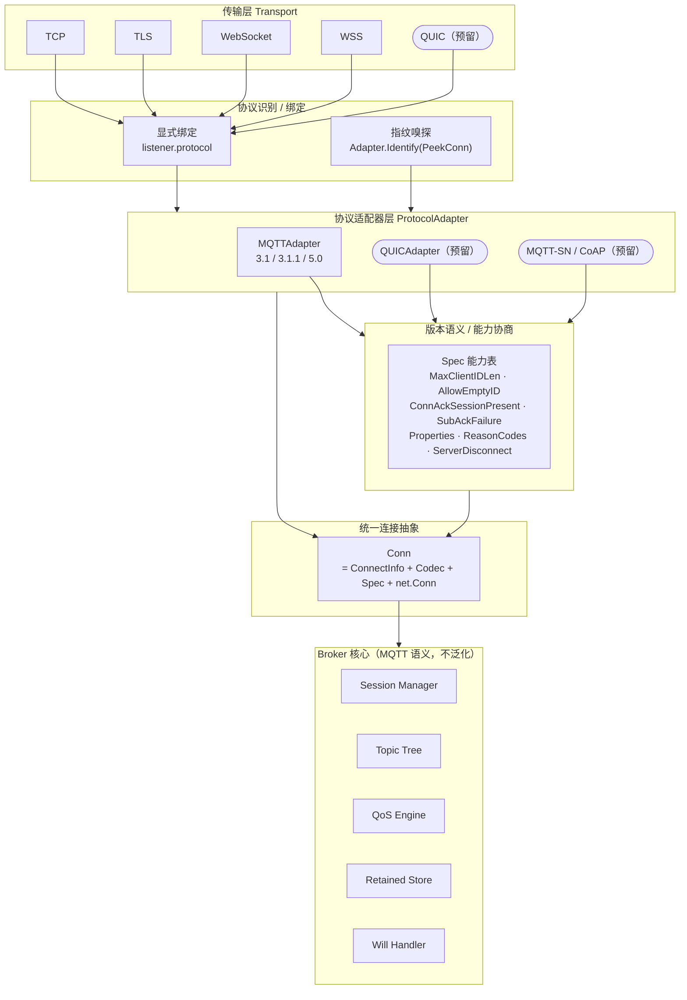
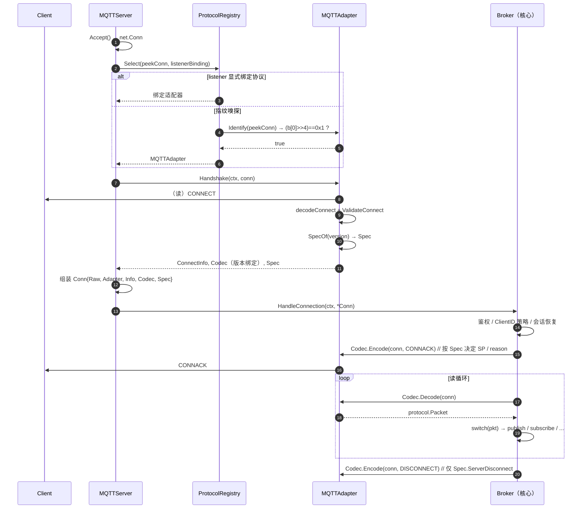
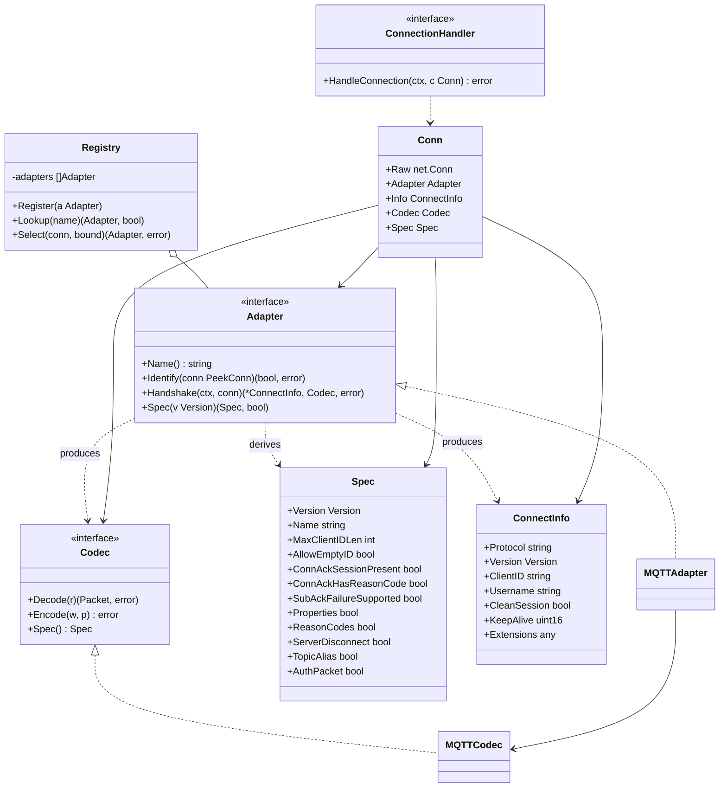

# Shark-MQTT 协议适配层抽象与 MQTT 3.1 语义补齐 — 架构设计

> 文档状态：设计稿（待评审）
> 作者：架构师 高见远（Gao）
> 适用范围：本次迭代「先完善协议适配」——**抽象出协议接入层骨架 + 补齐 MQTT 3.1 语义差异**，为 QUIC / MQTT-SN / CoAP 预留可插拔接口，**本次不实现这些新协议**。
> 代码基线：`github.com/X1aSheng/shark-mqtt`，Go 1.26，27,265 行非测试代码，375 单测 + 111 集成测试 + 65 基准全绿。

---

## 0. 结论速览（TL;DR）

1. **MQTT 3.1 是"半实现"**：协议层只有常量（`protocol/constants.go:68`）与 CONNECT 层的协议名/版本校验（`protocol/connect.go:146-155`），**Broker 语义层完全没适配**——`broker/broker.go` 全部 13 处版本分支都是二值判断 `== protocol.Version50`，3.1 连接**会被当作 3.1.1 处理**。
2. **`ConnectionHandler` 的 `codec` 参数是死参数**：`broker/server.go` 的两处调用点（`:269` acceptLoop、`:398` wsHandler）**都传 `nil`**；codec 实际由 `Broker.HandleConnection`（`broker/broker.go:161-165`）自行创建。根因是「版本是 CONNECT 解码的**结果**」，服务器在握手前无法构造版本绑定的 codec，于是把该职责下沉到了 Broker——这使 Broker 被迫承担 MQTT 握手，破坏了协议无关性。
3. **方案**：引入 ①**版本语义表 `Spec`**（把散落的 `== Version50` 收敛到一处能力查询）②**`Adapter` 协议适配器接口**（识别 + 握手 + codec + Spec 的唯一接缝）③**协议中立的 `Conn`**（`ConnectionHandler` 签名去 MQTT 化）。新增协议只需实现 `Adapter`，**Server 与 Broker 核心零改动**。
4. **抽象边界**：QoS/会话/订阅/保留消息是 **MQTT 语义**，**不下沉、不泛化**，仍留在 Broker 核心；只把「传输帧格式 + 协议识别 + 版本语义/能力」下沉到适配层。
5. **零回归硬约束**：3.1.1 / 5.0 行为必须逐字节不变；改动集中在「新增分支」与「等价的语义查询替换」，并配套 3.1 差异回归矩阵。

---

## 1. 协议接入现状分析

### 1.1 耦合点清单（"只有 MQTT"的假设分布）

| 位置 | 耦合形态 | 说明 |
|---|---|---|
| `broker/server.go:51-53` | `ConnectionHandler.HandleConnection(ctx, conn, codec *protocol.Codec)` | 接口签名直接暴露 MQTT 具体类型 `*protocol.Codec`，非 MQTT 协议无法表达 |
| `broker/server.go:269`、`:398` | `handler.HandleConnection(s.ctx, c, nil)` | codec 恒为 `nil`——见 §1.2 |
| `broker/broker.go:161-222` | Broker 自行 `c.Decode(conn)` 并 `pkt.(*protocol.ConnectPacket)` | **Broker 直接解析 MQTT 握手报文**，协议识别与握手职责错位 |
| `broker/broker.go` 13 处 | `== protocol.Version50` 二值分支 | 版本语义散落，见 §1.4 |
| `broker/clientState.codec`（`broker/broker.go:27`） | 连接状态字段是 MQTT codec 类型 | 连接状态与具体协议绑定 |
| `protocol/codec.go:35-47` | `Codec` 持有可变 `protocolVersion` | 编解码器把"版本"当可变状态，且默认写死 4 |
| `protocol/connect.go:136-194` | `ValidateConnect` 硬编码版本集合与协议名映射 | 语义校验内嵌在协议包，但**不感知 3.1 的 ClientID 规则** |
| `config/config.go:19-83` | `Config` 单 listener 结构（`ListenAddr`/`WSListenAddr`/`WSSListenAddr`） | 无 listener 数组、无协议绑定字段 |
| `broker/server.go:103-154` | `Start` 按固定字段起 TCP + WS + WSS | 传输拓扑硬编码，无法表达「某 listener 说某协议」 |
| `broker/ws_conn.go:13-19` | `packetFlusher` 接口 | 传输层抽象已部分存在（WS 适配 `net.Conn`），可复用为适配层基础 |

### 1.2 `ConnectionHandler` 接口设计缺陷（重点）

```go
// broker/server.go:49-53  现状
type ConnectionHandler interface {
    HandleConnection(ctx context.Context, conn net.Conn, codec *protocol.Codec) error
}
```

**缺陷一：`codec` 参数为什么是死的？**
`codec` 在 `broker/server.go:269` 与 `:398` 两处调用点**都传 `nil`**，从未真正被 server 使用；唯一非 nil 的传参来自测试（`broker/broker_test.go:105`、`broker/audit_fixes_test.go:41` 等）。真实 codec 由 `Broker.HandleConnection` 内部创建（`broker/broker.go:162-165`）：

```go
func (b *Broker) HandleConnection(ctx context.Context, conn net.Conn, codec *protocol.Codec) error {
    c := codec
    if c == nil {
        c = protocol.NewCodec(b.opts.maxPacketSize)   // 默认协议版本 = 4
    }
    ...
}
```

**根因**：MQTT 的协议版本是 **CONNECT 报文解码的产物**（`protocol/connect.go:23-27` 在 `decodeConnect` 里把 `protoVer` 写进 `c.protocolVersion`）。server 在握手前**不知道版本**，因此无法构造"版本正确"的 codec；把 codec 传进来也只会是错的（默认 4）。于是设计者选择了"传 nil、让 Broker 自己造"——**接口参数与实现职责自相矛盾**。

**缺陷二：签名无法表达协议选择。** 一个 QUIC / CoAP 连接没有"MQTT codec"，该参数在语法上就排斥了非 MQTT 协议。

**缺陷三：职责错位。** 协议识别（这是哪种协议？什么版本？）与握手（读 CONNECT、校验）本应发生在「传输 → 协议」边界，现在却塞进了 Broker 核心，导致每加一个协议都要动 Broker。

**改造方向**（详见 §2.2）：
```
HandleConnection(ctx, conn net.Conn, codec *protocol.Codec)   // 现状：MQTT 化 + 死参数
        ↓
HandleConnection(ctx, c *Conn)                                 // 目标：协议中立
// Conn = { Raw net.Conn; Adapter protocol.Adapter; Info *ConnectInfo; Codec protocol.Codec; Spec protocol.Spec }
```
识别、握手、codec 构造、版本语义全部前移到 `Adapter`，Broker 只消费协议中立的 `ConnectInfo`。

### 1.3 Broker 违反协议无关性的确切位置

- **握手解析**：`broker/broker.go:210-222` —— `c.Decode(conn)` + 类型断言 `*protocol.ConnectPacket` + `protocol.ValidateConnect`。
- **CONNACK 直接编码**：`sendConnAckRaw`（`:2274`）、`sendConnAck`（`:2175`）、`buildConnAck`（`:2264`）、`buildConnAckProperties`（`:2199`）——直接构造 `*protocol.ConnAckPacket`。
- **读循环按 MQTT 包类型分发**：`readLoop`（`:1079-1199`）`switch pkt.(type)`。
- **13 处版本二值分支**（§1.4）。

### 1.4 版本分支清单（`broker/broker.go` 13 处 + `protocol` 包 ~27 处）

> 全部为 `== protocol.Version50` / `!= protocol.Version50` 的二值判断，**没有第三态**，因此 3.1 必然落入 3.1.1 分支。

| # | 位置 | 当前语义（5.0 ? A : B） | 收敛后的 `Spec` 字段 |
|---|---|---|---|
| 1 | `broker.go:229` | CONNECT 校验失败：5.0 用 `0x82 ProtocolError`，否则 `0x01` | `ConnAckHasReasonCode` |
| 2 | `broker.go:241` | ClientID 超长：5.0 用 `0x85`，否则 `0x02` | `ConnAckHasReasonCode` |
| 3 | `broker.go:285` | 鉴权失败：5.0 用 `0x86`，否则 `0x04` | `ConnAckHasReasonCode` |
| 4 | `broker.go:309` | 会话属主不符（内存）：5.0 用 `0x87`，否则 `0x05` | `ConnAckHasReasonCode` |
| 5 | `broker.go:322` | 会话属主不符（store）：同上 | `ConnAckHasReasonCode` |
| 6 | `broker.go:1187` | 二次 CONNECT：5.0 才发服务端 DISCONNECT | `ServerDisconnect` |
| 7 | `broker.go:1318` | QoS2 PID 复用 PUBREC reason：仅 5.0 携带 | `ReasonCodes` |
| 8 | `broker.go:1406` | `ackDiscardedPublish` reason：仅 5.0 携带 | `ReasonCodes` |
| 9 | `broker.go:1431` | `closeProtocolViolation`：5.0 才发 DISCONNECT | `ServerDisconnect` |
| 10 | `broker.go:1619` | UNSUBACK reason codes：仅 5.0 生成 | `ReasonCodes` |
| 11 | `broker.go:1860` | 离线投递 MessageExpiry 属性：仅 5.0 下发 | `Properties` |
| 12 | `broker.go:1927` | 投递时 SubID / MessageExpiry 属性：仅 5.0 | `Properties` |
| 13 | `broker.go:2184` | CONNACK 挂 5.0 能力属性：仅 5.0 | `Properties` |

`protocol` 包内同类分支（`grep` 结果）：`subscribe.go` 15 处、`publish.go` 6 处、`connect.go` 6 处、`codec.go` 初始化 1 处——**全部迁移为 `c.spec.<字段>` 查询**。

---

## 2. 适配层目标设计

### 2.1 抽象层次图



### 2.2 核心接口草案（Go）

#### (a) 版本语义分发 —— `protocol/spec.go`（新增）

> 目的：把 §1.4 的 13 + 27 处二值分支，收敛为对 `Spec` 字段的一次查询。

```go
package protocol

// Version 采用类型别名，避免跨包（Session.ProtocolVer uint8 等）大规模改签名——
// 这是本次"零回归"约束下的低风险选择；后续可平滑升级为 defined type。
type Version = uint8

// Spec 是「某一协议版本」的统一语义与能力描述。
// 目标：broker / codec 不再对具体版本值做 if，而是查询能力字段。
type Spec struct {
    Version Version // 3 / 4 / 5

    // —— 握手 / 标识 ——
    Name           string // 协议名："MQIsdp"(3.1) / "MQTT"(3.1.1、5.0)
    AllowEmptyID   bool   // 3.1:false；3.1.1/5.0:true（且要求 CleanSession/CleanStart=1）
    MaxClientIDLen int    // 3.1:23；3.1.1/5.0:0（= 仅受服务端上限约束）

    // —— CONNACK 语义 ——
    ConnAckSessionPresent bool // 3.1:false（该字节为保留位，必须为 0）；3.1.1/5.0:true
    ConnAckHasReasonCode  bool // 仅 5.0:true；3.1/3.1.1 用 0x00–0x05 返回码

    // —— SUBACK ——
    SubAckFailureSupported bool // 3.1:false（无 0x80 失败码）；3.1.1/5.0:true

    // —— 报文能力（决定是否编解码属性/reason/专有报文）——
    Properties       bool // 仅 5.0
    ReasonCodes      bool // 仅 5.0（PUBACK/PUBREC/PUBREL/PUBCOMP/DISCONNECT 携带 reason+properties）
    ServerDisconnect bool // 仅 5.0：服务端可主动下发 DISCONNECT
    TopicAlias       bool // 仅 5.0
    AuthPacket       bool // 仅 5.0（增强认证 §4.12）
}

func specV31() Spec {
    return Spec{Version: Version31, Name: ProtocolNameMQIsdp, MaxClientIDLen: 23}
}
func specV311() Spec {
    return Spec{Version: Version311, Name: ProtocolNameMQTT, AllowEmptyID: true, ConnAckSessionPresent: true, SubAckFailureSupported: true}
}
func specV50() Spec {
    return Spec{Version: Version50, Name: ProtocolNameMQTT, AllowEmptyID: true,
        ConnAckSessionPresent: true, ConnAckHasReasonCode: true, SubAckFailureSupported: true,
        Properties: true, ReasonCodes: true, ServerDisconnect: true, TopicAlias: true, AuthPacket: true}
}

// SpecOf 返回给定版本的语义描述；未知版本 ok=false。
func SpecOf(v Version) (Spec, bool) {
    switch v {
    case Version31:
        return specV31(), true
    case Version311:
        return specV311(), true
    case Version50:
        return specV50(), true
    default:
        return Spec{}, false
    }
}
```

配套：`Codec` 增补 `spec Spec` 字段与 `func (c *Codec) Spec() Spec`；`Session` 增补

```go
// broker/session.go
func (s *Session) Spec() protocol.Spec { sp, _ := protocol.SpecOf(s.ProtocolVer); return sp }
```

之后 §1.4 的每处 `== Version50` 改写为等价能力查询，例如：
```go
// broker.go:229 现状
if connectPkt.ProtocolVersion == protocol.Version50 { reasonCode = protocol.ConnAckProtocolError }
// 收敛后
sp, _ := protocol.SpecOf(connectPkt.ProtocolVersion)
if sp.ConnAckHasReasonCode { reasonCode = protocol.ConnAckProtocolError }
```

#### (b) 协议识别 + 握手 + codec 抽象 —— `protocol/adapter.go`（新增）

```go
package protocol

// PeekConn 是可窥探前缀字节的连接，供协议指纹识别使用（不消费字节）。
type PeekConn interface {
    net.Conn
    Peek(n int) ([]byte, error)
}

// ConnectInfo 是一次成功握手的协议中立结果。
// Broker 核心只消费 ConnectInfo，不再直接解析 MQTT CONNECT 报文。
type ConnectInfo struct {
    Protocol     string // "mqtt"
    Version      Version
    ClientID     string
    Username     string
    Password     []byte
    CleanSession bool
    KeepAlive    uint16
    WillTopic    string
    WillPayload  []byte
    WillQoS      uint8
    WillRetain   bool

    // Extensions 以不透明方式透传版本专有数据（如 MQTT 5.0 Properties），
    // 核心按需通过类型断言取用；非 MQTT 协议可放自己的结构。
    Extensions any
}

// Codec 是协议中立的编解码契约（现有 *protocol.Codec 将实现它）。
type Codec interface {
    Decode(r io.Reader) (Packet, error)
    Encode(w io.Writer, p Packet) error
    Spec() Spec
}

// Adapter 是「一种接入协议」的全部实现契约。
// 新增协议（MQTT-over-QUIC / MQTT-SN / CoAP）只需实现本接口，
// MQTTServer 与 Broker 核心均无需改动。
type Adapter interface {
    // Name 返回稳定协议标识，例如 "mqtt"。
    Name() string

    // Identify 判断该连接是否属于本协议。实现只能 Peek、不得消费字节；
    // 字节不足时返回 (false, nil)，交由其他适配器/超时处理。
    Identify(conn PeekConn) (bool, error)

    // Handshake 完成握手：读取并校验首个报文（MQTT 即 CONNECT），协商版本，
    // 返回协议中立 ConnectInfo 与版本绑定的 Codec。此阶段只做"线格式合法性"，
    // 不做鉴权/会话策略（那属于 Broker 核心）。
    Handshake(ctx context.Context, conn net.Conn) (*ConnectInfo, Codec, error)

    // Spec 返回给定版本的语义/能力描述（MQTT 实现直接复用 SpecOf）。
    Spec(v Version) (Spec, bool)
}
```

**MQTT 指纹如何判定？** MQTT 首字节的高 4 位是报文类型，CONNECT = `0x1`；因此 `(b[0] >> 4) == 0x1` 即可判定为 MQTT（3.1/3.1.1/5.0 三者首字节相同，**版本只能由 CONNECT 可变头协商**，这正是 `Identify` 只判"是不是 MQTT"、`Handshake` 才定版本的原因）。显式配置绑定可跳过嗅探（见 §5）。

```go
// protocol/mqtt_adapter.go（新增）核心逻辑示意
func (a *MQTTAdapter) Identify(conn PeekConn) (bool, error) {
    b, err := conn.Peek(1)
    if err != nil {
        return false, err
    }
    return (b[0]>>4) == byte(PacketTypeConnect), nil
}

func (a *MQTTAdapter) Handshake(ctx context.Context, conn net.Conn) (*ConnectInfo, Codec, error) {
    codec := NewCodec(a.maxPacketSize) // 临时 codec：仅用于解码 CONNECT
    // 应用 CONNECT 超时（当前在 broker.HandleConnection 内，迁移到此处）
    pkt, err := codec.Decode(conn)
    if err != nil { return nil, nil, err }
    cp, ok := pkt.(*ConnectPacket)
    if !ok { return nil, nil, ErrInvalidPacket }
    if err := ValidateConnect(cp); err != nil { return nil, nil, err }
    sp, ok := SpecOf(cp.ProtocolVersion)
    if !ok { return nil, nil, ErrInvalidPacket }
    // codec 已把协议版本写入内部状态；Spec 派生自同一版本，保持一致。
    return toConnectInfo(cp), codec, nil
}
```

> 说明：现有 `*protocol.Codec` 在 `decodeConnect` 内部设置 `protocolVersion`，因此「握手完成后」该 codec 天然是**版本绑定**的，可继续用于后续读写；`Spec()` 返回同一版本的 `Spec`。这避免了"读出 CONNECT 后才能确定版本、却需要一个版本正确的 codec"的循环依赖。

#### (c) 协议中立连接 —— `broker/conn.go`（新增）

```go
package broker

// Conn 是一个已完成识别与握手、协议中立的连接。
type Conn struct {
    Raw     net.Conn
    Adapter protocol.Adapter
    Info    *protocol.ConnectInfo
    Codec   protocol.Codec
    Spec    protocol.Spec
}

// ConnectionHandler 消费协议中立连接；不再暴露任何 MQTT 具体类型。
type ConnectionHandler interface {
    HandleConnection(ctx context.Context, c *Conn) error
}
```

#### (d) 协议注册表 + 选择策略 —— `protocol/registry.go`（新增）

```go
package protocol

// Registry 保存已注册的协议适配器，并按「显式绑定优先，指纹嗅探兜底」选择。
type Registry struct {
    adapters []Adapter
    byName   map[string]Adapter
}

func NewRegistry(adapters ...Adapter) *Registry
func (r *Registry) Register(a Adapter)
func (r *Registry) Lookup(name string) (Adapter, bool)

// Select 返回处理该连接的适配器：
//  1) 若 listener 显式绑定协议名，直接返回该适配器；
//  2) 否则遍历 adapters 依次 Identify(PeekConn)，首个命中者胜出。
func (r *Registry) Select(conn PeekConn, bound string) (Adapter, error)
```

### 2.3 抽象边界（哪些下沉 / 哪些留在 Broker）

| 职责 | 归属 | 理由 |
|---|---|---|
| 传输帧（TCP/TLS/WS/WSS，未来 QUIC） | 传输层 | 与协议语义无关 |
| 协议识别 / 显示绑定 | 适配层 | 「这是哪种协议」的决策点 |
| 握手线格式校验（CONNECT 结构、协议名/版本） | 适配层 | 属于线格式合法性，非业务策略 |
| 版本语义 / 能力（ClientID 长度、SessionPresent、reason 支持…） | 适配层（`Spec`） | 消除散落的版本分支 |
| **鉴权 / ACL / 会话策略 / ClientID 业务上限** | **Broker 核心** | 业务策略，协议无关 |
| **QoS 0/1/2 流程** | **Broker 核心** | MQTT 语义，**不泛化** |
| **会话（Clean Session / 过期 / 恢复）** | **Broker 核心** | MQTT 语义 |
| **订阅 / 通配符 / 共享订阅 / 保留消息 / Will** | **Broker 核心** | MQTT 语义 |

**内部语言边界（重要且刻意）**：本次完成后，Broker 核心的读循环**仍以 `protocol.Packet`（MQTT 报文词汇）为内部语言**，即 MQTT 适配器把线格式规范化为 `protocol.Packet` 后交给核心。这是有意的取舍：
- 它**足以**解决"每加一个协议都要动核心"的部分——凡是**复用 MQTT 报文格式、只更换传输/识别**的协议（典型：**MQTT over QUIC**，报文仍是 5.0），只需新增 `Adapter`，核心零改动。
- 对于**报文模型不同**的协议（CoAP / MQTT-SN），未来可在 `Adapter` 之下再引入一层可选的 `EventAdapter`（把协议操作映射为核心事件：Connect/Publish/Subscribe/Disconnect）。**本次不实现**，仅预留接口位置（见 §7）。

### 2.4 设计约束

- **不引入重量级依赖**：本次**不新增任何第三方依赖**（`go.mod` 保持不变）。`Spec`/`Adapter`/`Registry`/`Conn` 全部是标准库 + 现有类型。
- **保持可嵌入 / MIT 定位**：适配层代码量小、无全局状态、无 init 副作用。
- **零回归**：3.1.1 / 5.0 路径的**线上字节**与**状态机**必须不变；3.1 差异只通过新增分支 + `Spec` 查询实现。
- **向后兼容 API**：`protocol.NewCodec(int)`、`Broker.New(opts...)`、`api.NewBroker(opts...)` 等公开 API 不变；仅 `ConnectionHandler` 接口签名与 `Broker.HandleConnection` 变更（见 §4 风险说明）。

---

## 3. MQTT 3.1 / 3.1.1 / 5.0 差异矩阵（核心交付物）

> 状态判定：**已实现**（三版本语义正确）/ **半实现**（仅部分路径正确）/ **缺失**（未适配）。
> 证据均给出 `文件:行`。不确定处显式标注「待查证规范」。

### 3.1 版本与握手

| # | 差异点 | 3.1 | 3.1.1 | 5.0 | 当前实现状态 | 代码证据 |
|---|---|---|---|---|---|---|
| 1 | 协议名字符串 | `MQIsdp` | `MQTT` | `MQTT` | **已实现** | `protocol/constants.go:74-77`；校验 `protocol/connect.go:146-155` |
| 2 | 协议版本字节 | 3 | 4 | 5 | **已实现** | `protocol/constants.go:68-70`；合法集合 `protocol/connect.go:143` |
| 3 | ClientID 最大长度 | **23 字节** | 65535（服务端可放宽，≥23） | 65535 | **缺失（3.1 未强制）** | `protocol/connect.go:190-191` 注释明确"Allow up to 65535"；Broker 上限默认 128（`broker/options.go:71`）→ 3.1 客户端 24–128 字节 ID 会被放行 |
| 4 | 空（0 长度）ClientID | **不允许**（返回 `0x02 Identifier Rejected`） | 允许，须 CleanSession=1，服务端分配 | 允许，须 CleanStart=1，服务端分配 | **缺失（3.1 被误放行）** | `protocol/connect.go:181` 仅实现 3.1.1 规则（空 ID ⇒ CleanSession=1）；`broker/broker.go:334-337` 对空 ID 一律分配 |
| 5 | CONNACK `Session Present` 标志 | **无此标志**（首字节为保留位/「Topic Name Compression Response」，必须为 0） | 有（首字节 bit0） | 有（首字节 bit0） | **缺失/错误（3.1 会下发 SP）** | `protocol/connect.go:330-334` 无条件解析/编码 SP；`protocol/connect.go:367-393` `encodeConnAck` 无条件写 SP 字节；`broker/broker.go:552` 传 `isResuming` |

### 3.2 CONNACK / SUBACK 返回码

| # | 差异点 | 3.1 | 3.1.1 | 5.0 | 当前实现状态 | 代码证据 |
|---|---|---|---|---|---|---|
| 6 | CONNACK 返回码集合 | `0x00`–`0x05`（**6 个**） | `0x00`–`0x05`（**6 个，与 3.1 相同**） | 改为 Reason Code（`0x00`+`0x80+`） | **已实现** | 常量 `protocol/constants.go:80-99`；按版本选码 `broker/broker.go:229/241/285/309/322` |
| 7 | SUBACK 订阅失败码 `0x80` | **无失败码**（只能回 granted QoS 0/1/2；订阅失败无法上报，通常回 QoS0 或断连） | 新增 `0x80` | Reason Code | **缺失（3.1 会收到 0x80）** | 常量 `protocol/constants.go:140`；无条件写 `0x80`：`broker/broker.go:1511`、`:1544`、`:1556`、`broker/broker.go:1571`（经 `handleSubscribe`） |

> **对任务书的澄清（重要）**：任务描述假设「3.1 只有 6 个 CONNACK 码、3.1.1 有更多」——**实测两者 CONNACK 码集合相同（均为 6 个）**。"多出来的码"是 **SUBACK 的 `0x80` 订阅失败码**（3.1.1 新增）与 **5.0 的 Reason Code 体系**，二者不是同一维度。矩阵以规范实际差异为准。

### 3.3 固定头 / 报文细节

| # | 差异点 | 3.1 | 3.1.1 | 5.0 | 当前实现状态 | 代码证据 |
|---|---|---|---|---|---|---|
| 8 | 固定头保留位校验严格度 | 规范对保留位约束较松、未明确定义违规处理（**待查证规范**具体条款） | 明确每类报文的 flag 值，违规视为 Malformed | 同 3.1.1 | **半实现**（对 3.1 亦套用 3.1.1 严格规则，通常更安全，但与 3.1 "宽松"预期存在语义差） | `protocol/codec.go:123-147` `validateFixedHeaderFlags` |
| 9 | QoS 0 PUBLISH 的 DUP 必须为 0 | 未明确 | 必须为 0（3.1.1 明确） | 必须为 0 | **缺失** | `protocol/codec.go:124-128` 未校验；`protocol/publish.go:11-97` 未校验 QoS0 的 DUP |
| 10 | 零字节 payload 的 RETAIN 报文 | 规范未明确"不得存储"（**待查证规范**） | **不得存储**，等价于删除 | 同 3.1.1 | **已实现** | `broker/broker.go:1472-1483`（空 payload → `DeleteRetained`） |

### 3.4 订阅 / 会话语义 / KeepAlive / Topic

| # | 差异点 | 3.1 | 3.1.1 | 5.0 | 当前实现状态 | 代码证据 |
|---|---|---|---|---|---|---|
| 11 | SUBSCRIBE 选项字节保留位 | 保留位须为 0（**待查证规范**） | bits2–7 保留须为 0 | 全字节定义（QoS/NoLocal/RAP/RetainHandling） | **已实现** | `protocol/subscribe.go:54-61` |
| 12 | Clean Session 语义 | 有 Clean Session | 同 3.1（语义澄清） | 更名 Clean Start + Session Expiry Interval | **已实现** | `protocol/connect.go:34-42`；`broker/broker.go:416-434`、`:384-400` |
| 13 | Will Retain / Will 语义 | 支持 Will + Will Retain | 同 3.1 | 增加 Will Delay / Will Properties | **已实现** | `protocol/connect.go:37,66-87`；`broker/broker.go:524-540` |
| 14 | KeepAlive 处理 | 1.5× deadline | 同 3.1 | 同 + `Server Keep Alive` 属性 | **已实现** | `broker/broker.go:1069-1077`（1.5×）；5.0 属性 `broker/broker.go:465-471` |
| 15 | Topic 长度与通配符语义 | 受 RemainingLength 约束；`+`/`#` 同 | 明确 UTF-8；过滤语义同 | 同 + Shared / Subscription Identifier / Topic Alias | **已实现** | `protocol/codec.go:308-327`（≤65535）；`protocol/topic.go`；`broker/broker.go:1231-1259` |
| 16 | UTF-8 字符串校验 | 未强制（**待查证规范**） | 强制 UTF-8 | 强制 UTF-8 | **已实现**（对 3.1 更严） | `protocol/codec.go:293-306` |
| 17 | 服务端 → 客户端 DISCONNECT | 3.1 允许（无 reason，**待查证规范**是否定义） | **3.1.1 无**服务端 DISCONNECT | 有（可带 reason/properties） | **半实现**（仅 5.0 发 DISCONNECT；3.1/3.1.1 直接关闭——对 3.1.1 正确，对 3.1 保守） | `broker/broker.go:1187`、`:1431`、`:1169-1176` |
| 18 | 服务端分配 ClientID 上报 | 无 | 无（隐式分配） | `Assigned Client Identifier` 属性 | **已实现** | `broker/broker.go:402-404`、`:2252-2254` |
| 19 | 属性 / Reason Code / Topic Alias / AUTH | 无 | 无 | 有 | **已实现** | `protocol/codec.go:55-121`、`protocol/publish.go:41`、`protocol/subscribe.go:30` 等按 `protocolVersion` 门控 |

### 3.5 差异矩阵结论

- **3.1 必须补齐的 4 项（本次范围）**：#3 ClientID≤23、#4 空 ClientID 拒绝、#5 CONNACK SessionPresent 置 0、#7 SUBACK 无 `0x80`（改判 QoS0）。
- **顺带校验的 1 项**：#9 QoS0 PUBLISH DUP=0（低成本、可加）。
- **标注待查证的 4 项**：#8、#10、#11、#16、#17 中带「待查证规范」的分支——**不臆造差异**，实现时以规范原文为准；若规范未强制，则维持现有（更严格）行为并加注释说明。

---

## 4. 兼容性与回归约束

### 4.1 硬约束
- **全量单元测试、集成测试与基准测试必须全绿**（当前计数与复现口径见 [测试指南](../guides/TESTING.md)；文档不写死数字，避免与源码漂移）。
- **3.1.1 / 5.0 行为零回归**：线上字节、状态机、错误码、日志语义不变。
- **属性段（property section）必须按 codec 版本门控**：属性段是 MQTT 5 独有的线格式，编码与解码两侧都以 `Spec.Properties` 为准。只判 `Properties != nil` 而不判版本，就会把 v5 属性字节写进 3.1/3.1.1 报文，对端会把它读成 payload、UNSUBSCRIBE 的 topic 列表或 SUBACK 的返回码，CONNACK 更会被解码器直接以 `ErrMalformedPacket` 拒绝。
  - 必选属性段（PUBLISH / CONNECT / 遗嘱 / CONNACK / SUBSCRIBE / UNSUBSCRIBE / SUBACK / UNSUBACK）统一走 `Codec.writePropertySection`；可选属性段（PUBACK / PUBREC / PUBREL / PUBCOMP / DISCONNECT / AUTH）由各编码器自带的 reason-code（或 `Spec.AuthPacket`）检查兜底，编码器在 `ErrMalformedPacket` 与 `ErrUnsupportedVersion` 之间选择即可。
  - pre-v5 codec 收到带属性的包**一律报错，不静默丢弃**：与 `encodeConnect` 拒绝超长 will 的策略一致，静默丢弃等于隐藏调用方的版本错配。
  - 需要显式绑定版本时用 `Codec.NewCodecForVersion`。`NewCodec` 默认 3.1.1，只在解码 CONNECT（`protocol/connect.go`）或编码 CONNECT（按 `pkt.ProtocolVersion` 重绑）时升级；因此「先发过 v5 CONNECT」的 codec 已是 v5，这一点会掩盖门控遗漏，不能作为正确性依据。
- **§3.3.2.3 中继数据必须穿过「QoS 2 暂存」与「会话重启」两条路径**：需要中继的 PUBLISH 属性（Payload Format Indicator / Content Type / Response Topic / Correlation Data / User Properties）与 Message Expiry 的绝对截止时间，不能只存在于在线投递路径。QoS 2 发布在 PUBREL 之前暂存于 `InboundQoS2`，重启后的重传则要经过「会话快照 -> store -> 恢复」，任何一环不带属性，属性都会静默丢失，§3.3.2.3.2 也随之失效。
  - store 层用独立的 `store.MessageProperties` 承载，**不持久化 `protocol.Properties`**：后者有三十余个字段，多数是 per-packet 或 server-scoped，直接落盘等于让每个未来的协议字段自动成为存储 schema。与 `Subscription.SubscriptionIdentifier` 同一先例。
  - Message Expiry **落盘绝对截止时间而非 interval**（`store.InflightMessage.ExpiresAt`），重传时按剩余时间重新推导 interval，否则重启会把首次发送时的值原样再宣告一次。
  - `store.InflightMessage` / `store.MessageProperties` 的 JSON 布局**是持久化格式**（`store/badger` 与 `store/redis` 直接 `json.Marshal(SessionData)`），只允许**追加字段**，不得重命名或改语义；跨版本兼容由 `store/inflight_json_test.go` 固定。
- **保留消息（RETAIN）同样要保存中继数据与过期截止时间**：retained 消息是「现在存储、以后投递」，而 §3.3.1.3 要求 Server「store the Application Message」——那个 Application Message 包含它的属性。因此 `store.RetainedMessage` 也必须携带 `MessageProperties` 与绝对截止时间：重放时按 §3.3.2.3 原样转发五类属性，按 §3.3.2.3.3 把 Message Expiry 递减为「收到的值减去在 Server 中等待的时间」，已过期的 retained 消息则不再投递（§3.3.1.3）。
  - `RetainedStore.SaveRetained` 接收完整的 `*RetainedMessage`，而不是 `(topic, qos, payload)`：三个参数表达不了属性与截止时间，任何后端都只能把它们丢掉，而且三个后端会各自重建记录、各自漂移。
  - **操作员的 `retained_expiry` TTL 与发布者的 Message Expiry 是两个独立上限**，取先到者；TTL 是运维策略，不作为 Message Expiry Interval 通告给订阅者（否则订阅者会看到一条它其实无权解释的过期值）。

### 4.2 主要回归风险与规避

| 风险 | 说明 | 规避手段 |
|---|---|---|
| R1 `ConnectionHandler` 签名变更 | 5 个测试文件 ~15 处调用点（`broker/broker_test.go`、`enhanced_auth_test.go`、`audit_fixes_test.go`、`server_test.go`）直接调用旧签名 | 机械式更新调用点为 `HandleConnection(ctx, *Conn)`；**断言不变**。旧测试用 `net.Pipe + NewCodec` 的形态封成 helper，保持测试意图 |
| R2 握手职责迁移 | CONNECT 解码从 `Broker.HandleConnection` 移到 `MQTTAdapter.Handshake`；`connect_timeout` 生效点随之移动 | 迁移时逐条对齐现有行为：超时值、错误计数（`IncRejections("decode_error")`）、`isEarlyClose` 判定、CONNACK 拒绝码保持不变；用现有 `TestBroker_HandleConnection_*` 做护栏 |
| R3 `Spec` 改写分支 | 若字段映射错误，可能改变 3.1.1/5.0 返回码或属性门控 | 逐条对照 §1.4 表格；新增 `protocol/spec_test.go` 断言三版本字段取值；`Spec` 改写前后对同一 `ConnectPacket` 输出做差分测试 |
| R4 codec 版本可变状态 | `Codec.protocolVersion` 仍由 decode 设置，跨连接复用会串版本 | 明确 codec **每连接一个**（现状即如此，`broker.go:162`）；补注释与断言；禁止全局/池化 codec |
| R5 3.1 严格化"误伤" | 若某遗留部署用 3.1 + 长 ClientID，严格化后会被拒（`0x02`） | 提供 `mqtt31_enabled` 开关（默认 true）；关闭时回退为「3.1 按 3.1.1 宽松处理」的旧行为（见 §5.3） |
| R6 配置结构新增 | `Listeners []ListenerConfig` 若与旧字段冲突 | `EffectiveListeners()` 归一化：`Listeners` 非空优先；否则由旧字段合成，**旧配置零修改可跑**（见 §5） |
| R7 SUBACK `0x80` 语义 | 3.1 分支改为回 QoS0，可能影响既有 ACL 拒绝测试 | 仅对 `Spec.SubAckFailureSupported == false`（即 3.1）生效；3.1.1/5.0 仍回 `0x80`，现有测试不受影响 |
| R8 属性段门控遗漏 | 编码器只判 `Properties != nil`、不判 `Spec.Properties`，把 v5 属性字节写进 3.1.1 报文（对端读成 payload / topic 列表 / 返回码，CONNACK 直接被拒）。历史上 `encodePublish`、`encodeConnAck`、`encodeSubscribe`、`encodeUnsubscribe`、`encodeSubAck` 都漏过，且因为 codec 已被 v5 CONNECT 绑定而不可达，只能靠人工审查发现 | 必选属性段统一走 `Codec.writePropertySection`；`protocol/audit_fixes_test.go` 的 `TestPropertySectionVersionGatedAcrossPackets` 对每种报文断言三条：pre-v5 带属性必拒、pre-v5 无属性仍可编码、v5 带属性能编码 |
| R9 会话记录格式即持久化 schema | `store.InflightMessage` 被 `store/badger` 与 `store/redis` 直接 `json.Marshal`，字段重命名或语义变更会让已落盘的会话静默丢数据；中继属性若只加在在线投递路径，QoS 2 中转与重启重传都会丢属性 | 只追加字段、不改名；`store/inflight_json_test.go` 用旧快照字面量固定向后兼容并断言 nil / 空 slice 不被 JSON 互转；`broker/publish_properties_test.go` 的 `TestSessionRestoreKeepsForwardedProperties`、`TestSessionRestoreDropsExpiredInflight` 覆盖 保存 -> 恢复 -> 重传 全链路 |
| R10 保留消息丢失中继数据 | retained 记录原先只存 topic / QoS / payload，于是订阅时重放会丢掉全部 MQTT 5 中继属性并忽略发布者的 Message Expiry（§3.3.1.3 + §3.3.2.3），经 retained 引导的请求 / 响应永远无法完成；`store/memory` 的浅拷贝还会让调用方缓冲区与库内记录互相别名 | `store.RetainedMessage` 携带 `MessageProperties` + `ExpiresAt`，`SaveRetained` 改为接收完整记录使后端无法丢字段；`store/memory` 的 `GetRetained` / trie `match` / `collectAll` 统一走 `copyRetainedMessage` 深拷贝；`TestRetainedMessageRelaysPublisherProperties`、`TestRetainedMessageReplayDecrementsExpiry`、`TestRetainedMessageExpiredIsNotDelivered` 覆盖重放、递减与过期丢弃 |

### 4.3 护栏建议
- 新增 `tests/integration/mqtt31_test.go`：3.1 CONNECT 全流程（ClientID 边界 23/24、空 ID、CONNACK SP=0、SUBACK 无 `0x80`）。
- 新增 `protocol/spec_test.go`：三版本 `Spec` 字段快照。
- 回归门禁：在 CI 中先跑冻结的既有测试集，再跑新增用例。

---

## 5. 配置面设计

### 5.1 现状
`config/config.go:19-83` 是**单 listener 结构**：

```go
ListenAddr    string // TCP
WSListenAddr  string // WS
WSSListenAddr string // WSS
TLSEnabled / TLSCertFile / ... // 全局共享一份 TLS
```

问题：无法表达「listener 数组」与「某个 listener 绑定某个协议」；TLS 配置全局唯一。

### 5.2 目标：listener 数组 + 协议绑定（向后兼容）

```go
// config/config.go（新增，保留全部旧字段）
type ListenerConfig struct {
    Addr      string             `yaml:"addr"`      // ":1883"
    Transport string             `yaml:"transport"` // tcp | tls | ws | wss（默认 tcp）
    Protocol  string             `yaml:"protocol"`  // mqtt（默认）... 预留 quic / mqtt-sn / coap
    TLS       *TLSListenerConfig `yaml:"tls,omitempty"`
}

type TLSListenerConfig struct {
    CertFile   string `yaml:"cert_file"`
    KeyFile    string `yaml:"key_file"`
    MinVersion uint16 `yaml:"min_version"`
    MaxVersion uint16 `yaml:"max_version"`
    Mutual     bool   `yaml:"mutual"`
    CACertFile string `yaml:"ca_cert_file"`
}

// Config 新增字段（其余旧字段全部保留）
//   Listeners      []ListenerConfig `yaml:"listeners"`
//   MQTT31Enabled  bool             `yaml:"mqtt31_enabled"`  // 默认 true

// EffectiveListeners 归一化：Listeners 非空则优先；
// 否则把旧的 ListenAddr / WSListenAddr / WSSListenAddr 合成为等价 listener，
// 协议一律 "mqtt"，Transport 依字段/TLSEnabled 推断。
// 保证「旧配置零修改仍可运行」。
func (c *Config) EffectiveListeners() []ListenerConfig
```

**向后兼容要点**：
- 旧字段（`ListenAddr`/`WSListenAddr`/`WSSListenAddr`/`TLSEnabled`…）**全部保留且语义不变**；`MQTTServer` 改为消费 `EffectiveListeners()`。
- `Config.Validate()` 增加：`Listeners` 非空时校验各项 `transport`/`protocol` 合法性；`TLS` 传输必须有 `tls` 段。
- 冲突检测：若同时设置了 `Listeners` 与旧字段，以 `Listeners` 为准并 `Warn`（不报错）。

### 5.3 3.1 开关
- `MQTT31Enabled bool`，**默认 true**（本次目标就是补齐 3.1；且当前 3.1 已被接受，默认开启不改变"能否连"的能力）。
- 关闭时：`Spec` 对 3.1 退化为 3.1.1 能力（`AllowEmptyID=true`、`ConnAckSessionPresent=true`、`SubAckFailureSupported=true`、`MaxClientIDLen=0`），即**回退到当前宽松行为**，用于保护依赖旧行为的部署。
- 该开关只影响 3.1，**不影响 3.1.1/5.0**。

---

## 6. 任务分解（给工程师直接用，按依赖排序）

> 量级：S（≤0.5 天）/ M（1–2 天）/ L（≥3 天）。风险：低/中/高。

| 任务 | 描述 | 涉及文件（相对路径） | 量级 | 风险 | 依赖 | 验收方式 |
|---|---|---|---|---|---|---|
| **T01** | **版本语义层**：新增 `Spec`/`SpecOf` 三版本能力表；把 `protocol` 包内全部 `== Version50` 分支（subscribe/publish/connect/codec）改写为 `c.spec.*`；`Codec` 增 `spec` 字段与 `Spec()` | `protocol/spec.go`(新)、`protocol/constants.go`、`protocol/codec.go`、`protocol/connect.go`、`protocol/publish.go`、`protocol/subscribe.go`、`protocol/spec_test.go`(新) | M | 中 | — | `go test ./protocol/...` 全绿；`spec_test.go` 三版本字段快照；3.1.1/5.0 编解码字节与改前一致 |
| **T02** | **适配器抽象**：新增 `Adapter`/`Codec`/`ConnectInfo`/`PeekConn` 接口、`MQTTAdapter` 实现（识别=首字节 `0x1x`；握手=解 CONNECT + 校验 + 派生 Spec）、`Registry`（显式绑定优先 + 嗅探兜底） | `protocol/adapter.go`(新)、`protocol/mqtt_adapter.go`(新)、`protocol/registry.go`(新)、`protocol/adapter_test.go`(新) | M | 低 | T01 | 单元测试：嗅探/绑定选择、握手产出 `ConnectInfo/Spec` 正确；不改动线上路径 |
| **T03** | **接入接缝重构**：`ConnectionHandler` 改签名 `HandleConnection(ctx, *Conn)`；新增 `broker/conn.go`；`MQTTServer` 接入 `Registry`（识别→握手→构造 `Conn`）+ 迁移 `connect_timeout`；`Broker.HandleConnection` 消费 `ConnectInfo`（删除自身 CONNECT 解码）；`api/api.go` 接线 | `broker/server.go`、`broker/conn.go`(新)、`broker/broker.go`、`broker/options_server.go`、`api/api.go`、`broker/*_test.go`（签名适配） | L | **高** | T01,T02 | 全量 `go test ./broker/... ./tests/integration/...`；`TestBroker_HandleConnection_*`、增强认证、早期关闭用例保持通过 |
| **T04** | **MQTT 3.1 语义补齐**：`ValidateConnect` 增 3.1 规则；CONNACK 按 `Spec.ConnAckSessionPresent` 置 0；SUBACK 按 `Spec.SubAckFailureSupported` 处理（3.1 回 QoS0）；补 QoS0 DUP=0 校验（可选） | `protocol/connect.go`、`broker/broker.go`、`broker/session.go`、`broker/options.go`、`tests/integration/mqtt31_test.go`(新)、`protocol/connect_test.go` | M | 中 | T01,T03 | `mqtt31_test.go` 通过；`TestValidateConnectProtocolNameMatchesVersion` 仍绿；3.1.1/5.0 无差异 |
| **T05** | **配置面 + 文档**：新增 `ListenerConfig`/`EffectiveListeners`/`MQTT31Enabled`；`MQTTServer` 改消费 `EffectiveListeners()`；更新 README/config 示例 | `config/config.go`、`config/loader.go`、`config/config_test.go`、`broker/server.go`、`README.md`、`README.zh-CN.md` | M | 中 | T03 | 旧配置零修改可启动；新 `listeners` 配置生效；`config_test.go` 覆盖归一化与校验 |

**并行建议**：T01 为关键路径起点；T02 可与 T01 尾部并行；T04 因与 T03 同改 `broker/broker.go`，建议 **T03 完成后串行**；T05 依赖 T03。

> 说明：本分解比"3 个粗粒度任务"更细，便于工程师按依赖推进；主理人任务清单中的「实现协议适配层与 MQTT 3.1 语义补齐」= **T01–T04**，「QA 验证」= **T04–T05 的验收 + 新增 3.1 用例**。

---

## 7. 明确不做的范围

| 排除项 | 理由 |
|---|---|
| **QUIC / MQTT-SN / CoAP 的实际实现** | 本次只做抽象与预留（`Adapter` 接口 + `Registry` + `listener.protocol` 字段）。协议实现依赖本次抽象稳定后再单独立项 |
| **引入通用事件模型（`EventAdapter`）** | 属 §2.3 的"Level 2"扩展；本次以 `protocol.Packet` 为内部语言已满足 MQTT-over-QUIC 等场景，避免过度设计与大面积改动核心 |
| **重写 QoS / 会话 / 订阅 / 保留消息为协议中立** | 这些是 MQTT 语义，泛化会带来语义损失与零回归风险，**刻意保留** |
| **新增第三方依赖** | 违反"零依赖 / 可嵌入 / MIT"定位 |
| **3.1 与 3.1.1 之外的历史版本（如 MQTT 2.x）** | 无用户需求，避免范围蔓延 |
| **TLS/证书配置的 per-listener 运行时热加载** | 本次仅提供 per-listener 静态 TLS 配置（`TLSListenerConfig`），热加载不在范围 |
| **`Spec` 由 `type Version = uint8` 升级为 defined type** | 低收益、高 churn（牵动 `Session.ProtocolVer`、`store.SessionData.ProtocolVer` 及大量比较），留待后续 |

---

## 附录 A：连接建立时序（目标态）



## 附录 B：适配层类/接口关系



---

## 附录 C：引用索引（核对过的代码事实）

- `protocol/constants.go:68-70` 版本常量；`:74-77` 协议名；`:80-99` CONNACK 码；`:140` `SubAckFailure=0x80`
- `protocol/codec.go:35-47` `Codec` 结构 + `NewCodec`；`:55` `Decode`；`:123-147` 固定头校验；`:150` `Encode`
- `protocol/connect.go:23-27` decode 时写版本；`:138-155` 协议名/版本校验；`:181` 空 ID 规则；`:190-191` 3.1 长度注释；`:321-393` CONNACK 编解码
- `protocol/publish.go:41,83,121,149,292,337`；`protocol/subscribe.go:30,56,98,165,203,245,286,312,342,367,384,421,462,490,534` 版本分支
- `broker/server.go:49-53` `ConnectionHandler`；`:103-154` `Start`；`:223-279` `acceptLoop`（`:269` 传 nil）；`:336-368` `startWS`；`:372-403` `wsHandler`（`:398` 传 nil）
- `broker/broker.go:25-47` `clientState`；`:159-564` `HandleConnection`；`:1079-1199` `readLoop`；13 处版本分支见 §1.4
- `broker/session.go:16-20` `Session.ProtocolVer`；`:174,198` 赋值；`broker/session_types.go`；`store/types.go:14` `ProtocolVer`
- `config/config.go:19-83` 单 listener 结构；`:86-107` 默认值；`:110-169` `Validate`
- `broker/ws_conn.go:13-19` `packetFlusher`
- `broker/options.go:71` `maxClientIDLength=128`
- 测试调用点：`broker/broker_test.go:105,124,515`、`broker/enhanced_auth_test.go:116,158,183,210`、`broker/audit_fixes_test.go:41,947`、`broker/server_test.go:81,101`
- 规范差异交叉核对来源（MQTT 3.1 → 3.1.1 变更）：Session Present Flag（新增）、SUBACK 失败码 `0x80`（新增）、匿名 ClientID（新增，须 CleanSession=1）、ClientID 上限 23→65535、协议名 `MQIsdp`→`MQTT`、协议版本 3→4、QoS0 DUP 必须为 0、字符串统一 UTF-8、MQTT over WebSocket 定义。—— 标注「待查证规范」的分支以 OASIS MQTT 3.1.1 / 3.1 原文为准。
